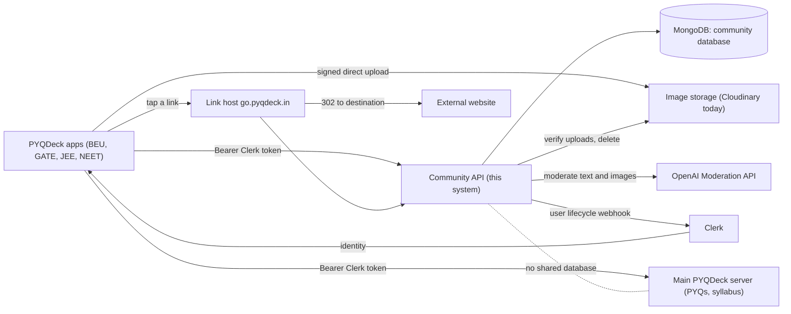
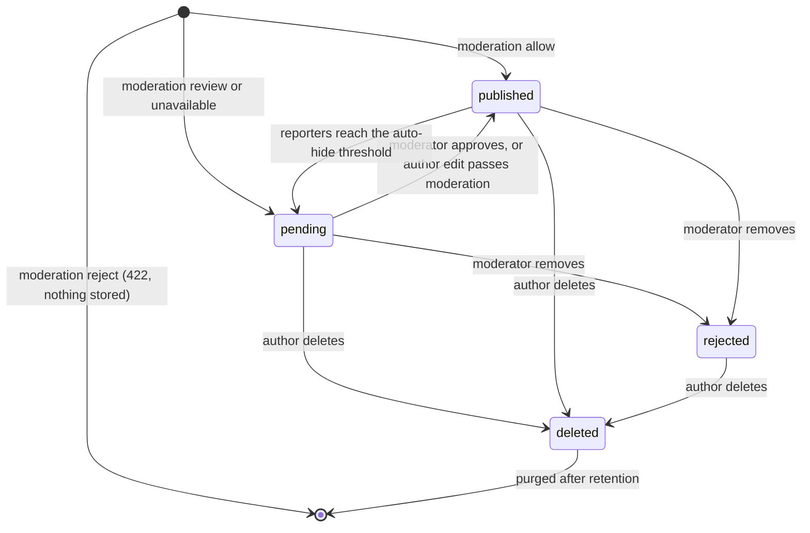
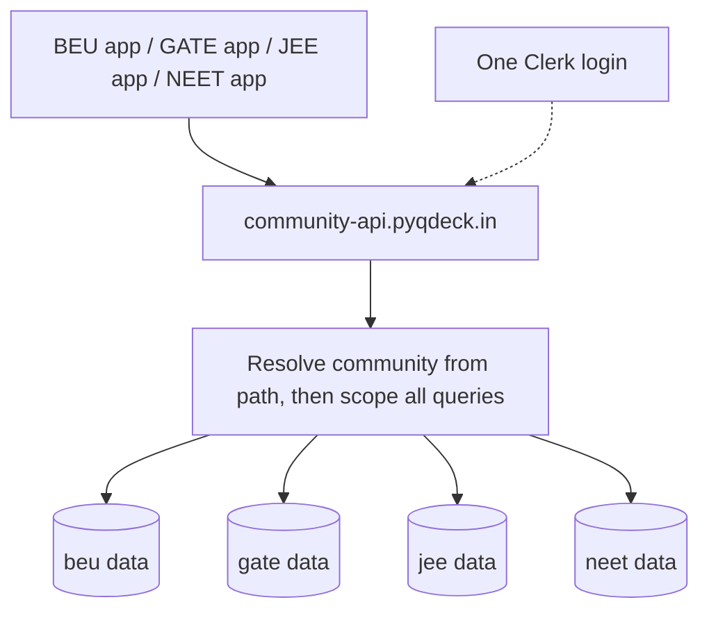

# Software Requirements Specification: PYQDeck Community Service

Structured after ISO/IEC/IEEE 29148:2018 (Systems and software engineering — Life cycle processes — Requirements
engineering), which supersedes IEEE Std 830-1998. Requirement attributes follow clause 5.2.5 of that standard.

| Field            | Value                                                                                                                                                                                                                                                                                                                           |
| ---------------- | ------------------------------------------------------------------------------------------------------------------------------------------------------------------------------------------------------------------------------------------------------------------------------------------------------------------------------- |
| System           | PYQDeck Community Service (`pyqdeck-community`) and its client SDK                                                                                                                                                                                                                                                              |
| Client           | PYQDeck mobile app (`pyqdeck-expo`)                                                                                                                                                                                                                                                                                             |
| Document version | 1.5 (draft for review)                                                                                                                                                                                                                                                                                                          |
| Date             | 2026-10-17                                                                                                                                                                                                                                                                                                                      |
| Status           | Draft. Reverse-engineered from the Expo app's mock community feature, plus owner decisions recorded in section 1.2 and Appendix E (v1.1 adds the multi-community design; v1.2 records the answers to the blocking questions; v1.3 adds safe external links; v1.4 adds the lifecycle state machines; v1.5 records what is built) |
| Audience         | Product owner, backend and app developers, QA, reviewers                                                                                                                                                                                                                                                                        |

**Requirement conventions.** IDs use the team's existing prefixes: `FR-` functional, `NFR-` non-functional,
`IR-` interface, `CR-` constraint. Priority is MoSCoW (**M** must, **S** should, **C** could). Every requirement is
phrased with "shall" and is meant to be singular and testable. **Source** says where it came from: `App:` a behaviour
observed in `pyqdeck-expo` (file named), `Owner:` a decision by the product owner, `Proposed:` introduced here because
the app does not yet cover it. **Status** is the state of the backend today: `Built`, `Partial`, `Not built`.
**V** is the verification method: **T** test, **I** inspection, **D** demonstration, **A** analysis. Items marked
**TBD-n** need a decision; they are listed with recommendations in Appendix E.

---

## 1. Introduction

### 1.1 Purpose

This document specifies the requirements for the PYQDeck Community Service: the backend that replaces the in-memory
mock (`src/data/mockCommunity.ts`, `src/services/userProfileService.ts`) behind the community features of the PYQDeck
app. It is the reference for design, implementation, test and acceptance of the service and of the client SDK that the
app will use to call it.

### 1.2 Scope

PYQDeck is a study companion for students of Bihar Engineering University (BEU). The **main server**
(`D:\projects\PYQDECK\server`) owns previous-year papers, syllabus and notes. The **Community Service** specified
here is a separate server and database that adds a LinkedIn-style social space for the same students.

From version 1.1 it is a **multi-community** service: one deployment hosts independent communities, one per PYQDeck app (for example `beu`, `gate`, `jee`, `neet`). Communities are fully isolated from each other and a person's memberships in different communities are deliberately **unlinked** (FR-COM-*).

**In scope (this release)**

- **Multiple isolated communities** in one deployment, created at runtime, each with its own members, content, moderators, limits and moderation policy.
- **Safe external links**: every external URL in posts, comments and profile text is shown to readers as a short, checkable link on `go.pyqdeck.in`, with safety checks, a warning page for risky links, takedown and click counts.
- Profiles (a separate membership and persona per community, on top of one Clerk login).
- Posts: Markdown/LaTeX text, `#hashtags`, **images**, an optional link to a PYQ or syllabus topic.
- **Editing and deleting** one's own posts and comments.
- Comments with replies, likes on posts and comments, bookmarks.
- Follow / unfollow.
- Feed, hashtag filtering, trending hashtags, search.
- Activity notifications (comments, replies, likes, follows, moderation outcomes).
- Automated content moderation, user reports, blocking, a moderator workflow and an audit trail.
- Image storage across pluggable provider accounts, with failover.
- A TypeScript client SDK.

**Out of scope (this release)**

- **PDF and other document attachments.** Owner decision: images only for now. The app's document-slide UI
  (`CommunityDocumentSlide`) and `pdf` attachment type stay mock-only until a later phase (see TBD-3).
- **Direct messages.** The app shows "Direct messaging … will be available in the upcoming peer study update"
  (`UserProfileScreen.tsx`); the inbox's message items are mock data. Notification type `message` is reserved only.
- University notices ("BEU Exam Notice", type `system`): produced by the main server's admin tooling, not by this
  service (TBD-8).
- Advertisements: the app inserts inline ads client-side from main-server flags and the viewer's ad-free entitlement
  (`CommunityFeedScreen.tsx`). The Community Service neither serves nor tracks ads.
- Link preview cards (the title and image of a link's destination): deferred, because fetching arbitrary URLs from the server needs SSRF protection (TBD-26).
- Sign-up, sign-in, passwords and tokens: owned by Clerk.

### 1.3 Product overview

#### 1.3.1 Product perspective

The Community Service shares **only** the Clerk identity with the main server. It has its own database. References to
main-server content (a PYQ or topic) are stored as opaque identifiers and resolved by the app (TBD-9).

#### 1.3.2 Product functions

Authenticate via Clerk; maintain profiles; create, edit, delete and read posts; comment and reply; react and bookmark;
follow; search and filter; notify; moderate (automatically and by humans); store images; expose all of this through a
documented REST API and a TypeScript SDK.

#### 1.3.3 User characteristics

| Role            | Description                                                                                                                        |
| --------------- | ---------------------------------------------------------------------------------------------------------------------------------- |
| Visitor         | Not signed in. May read public content (TBD-1).                                                                                    |
| Member          | Signed-in student. Default role. Creates content, follows, reacts.                                                                 |
| Moderator       | Trusted member who reviews reports and held content **in one community**.                                                          |
| Community admin | Runs one community: moderators, suspensions, community settings.                                                                   |
| Platform admin  | Operates the whole service: communities, storage accounts.                                                                         |
| Short link      | The reader-facing form of an external URL, `https://go.pyqdeck.in/{code}`, that the service redirects to the original destination. |
| Link host       | The hostname that serves short links (`go.pyqdeck.in`); a setting, not stored in content.                                          |
| Interstitial    | A warning page shown before leaving PYQDeck through a link that is risky or not yet checked.                                       |
| SDK consumer    | A developer integrating the SDK in the app.                                                                                        |

Members are mostly students on mid-range Android phones with variable mobile connectivity, writing in English with
occasional Hindi. Content is exam-focused and includes mathematics (LaTeX).

#### 1.3.4 Limitations

- Only the login identity (Clerk id and email) is owned by Clerk. A member's display name, handle and avatar belong to each community membership and are prefilled from Clerk when they join (D-10).
- Image storage uses third-party free tiers that can run out; the system must keep working by moving to another account.
- Automated moderation depends on an external API and is probabilistic; it cannot replace human review.

### 1.4 Definitions

| Term           | Meaning                                                                                                     |
| -------------- | ----------------------------------------------------------------------------------------------------------- |
| Post           | A member's published item: text, optional images, optional linked resource.                                 |
| Community      | An isolated space served by the service, one per PYQDeck app, identified by a slug such as `beu` or `gate`. |
| Membership     | A person's presence in one community: their handle, profile, role, status and counters there.               |
| Account        | The global record of a Clerk user: Clerk id and private email. It owns memberships but is never exposed.    |
| Platform admin | An operator role across all communities (manages communities and storage).                                  |
| Comment        | A response to a post. A reply is a comment on a comment; replies display one level deep (see FR-CMT-3).     |
| Held           | Content not published, waiting for a moderator (post status `pending`).                                     |
| Removed        | Content taken down by a moderator (post status `rejected`).                                                 |
| Deleted        | Content removed by its author.                                                                              |
| Handle         | The public username used in profile URLs.                                                                   |
| Ticket         | A short-lived, signed instruction that lets the app upload a file straight to the storage provider.         |
| Escalate       | Flag on moderation events involving sexual content with minors, requiring a human and legal process.        |

---

## 2. References

1. ISO/IEC/IEEE 29148:2018, _Systems and software engineering — Life cycle processes — Requirements engineering_.
2. `pyqdeck-expo/docs/SRS-community.md` v2.0 (UI-level description of the shipped mock).
3. `pyqdeck-expo/docs/SRS-pyqdeck-app.md` (main app SRS; naming and ID conventions).
4. `pyqdeck-expo/docs/client-abuse-handling-plan.md` (client-side search guards; reused in FR-SRCH).
5. Source files observed: `src/types/community.ts`, `src/data/mockCommunity.ts`, `src/services/userProfileService.ts`,
   `src/screens/{CommunityFeedScreen,CommunityPostDetailScreen,UserProfileScreen,ActivityInboxScreen}.tsx`,
   `src/components/community/*`, `src/components/profile/EditProfileModal.tsx`, `src/api/index.ts`, `App.tsx`.
6. `pyqdeck-community/README.md`, `AGENTS.md`, and the OpenAPI document served at `/api/docs/json`.
7. OpenAI Moderation API guide: <https://developers.openai.com/api/docs/guides/moderation>.
8. Google Play _User Generated Content_ policy and Apple App Store Review Guideline 1.2 (user-generated content).
   Wording must be re-checked at release time (NFR-COMP-1).

---

## 3. Specific requirements

### 3.1 External interfaces

#### 3.1.1 User interfaces

The service has no UI of its own. The app's existing screens define the behaviour the API must support: Community feed,
post composer, post detail, comments sheet, user profile and edit-profile modal, Activity/inbox, hashtag filter bar,
and share/report menus. Screen-level layout is specified in `SRS-community.md` and is not repeated here.

#### 3.1.2 Hardware interfaces

None.

#### 3.1.3 Software interfaces

| ID      | Requirement                                                                                                                                                                                                                                | Pri | Source                              | Status  | V   |
| ------- | ------------------------------------------------------------------------------------------------------------------------------------------------------------------------------------------------------------------------------------------ | --- | ----------------------------------- | ------- | --- |
| IR-SW-1 | The system shall verify identity using Clerk session tokens issued to the same Clerk instance as the main server.                                                                                                                          | M   | App: `api/index.ts` (Bearer tokens) | Built   | T   |
| IR-SW-2 | The system shall receive Clerk user lifecycle events (`user.created`, `user.updated`, `user.deleted`) on a Svix-signed webhook dedicated to this service.                                                                                  | M   | Proposed                            | Built   | T   |
| IR-SW-3 | The system shall store images through a provider-independent storage interface; Cloudinary shall be the first provider.                                                                                                                    | M   | Owner                               | Built   | T   |
| IR-SW-4 | The system shall call the OpenAI Moderation API (`omni-moderation-latest`) for text and image moderation.                                                                                                                                  | M   | Owner                               | Built   | T   |
| IR-SW-5 | The system shall use a MongoDB database separate from the main server's.                                                                                                                                                                   | M   | Proposed                            | Built   | I   |
| IR-SW-6 | The system shall check link reputation through a replaceable provider interface; at launch the sources are free public feeds plus the system's own block list, with a commercial provider (Google Web Risk) as the planned upgrade (D-13). | M   | Owner                               | Partial | T   |

#### 3.1.4 Communications interfaces

| ID        | Requirement                                                                                                                                                                                                                                                                 | Pri | Source                                                                         | Status    | V   |
| --------- | --------------------------------------------------------------------------------------------------------------------------------------------------------------------------------------------------------------------------------------------------------------------------- | --- | ------------------------------------------------------------------------------ | --------- | --- |
| IR-API-1  | The system shall expose a JSON REST API over HTTPS under a versioned prefix (`/api/v1`); community-scoped routes shall live under `/api/v1/communities/{community}` (TBD-10).                                                                                               | M   | Proposed; Owner                                                                | Built     | I   |
| IR-API-2  | Success responses shall have the form `{ "success": true, "data": … }`; list responses shall add a `pagination` object.                                                                                                                                                     | M   | Proposed                                                                       | Built     | T   |
| IR-API-3  | Error responses shall have the form `{ "success": false, "message": string, "details"?: …, "requestId": string }` with a meaningful HTTP status.                                                                                                                            | M   | Proposed                                                                       | Built     | T   |
| IR-API-4  | Every response shall carry an `x-request-id` header equal to `requestId` in error bodies.                                                                                                                                                                                   | M   | Proposed                                                                       | Built     | T   |
| IR-API-5  | Rate-limited responses shall use HTTP 429 and include a `Retry-After` header, which the app already honours (`api/index.ts`).                                                                                                                                               | M   | App                                                                            | Built     | T   |
| IR-API-6  | Timestamps shall be ISO 8601 UTC strings; the client formats relative times such as "2h".                                                                                                                                                                                   | M   | App: mock uses "2h" strings                                                    | Built     | I   |
| IR-API-7  | List endpoints for feeds, comments and notifications shall use cursor pagination so inserts during scrolling cause no duplicates or gaps.                                                                                                                                   | M   | Proposed                                                                       | Built     | T   |
| IR-API-8  | The system shall publish an OpenAPI 3 document and Swagger UI outside production.                                                                                                                                                                                           | S   | Proposed                                                                       | Built     | I   |
| IR-API-9  | The system shall be served from one origin shared by all communities (production: `community-api.pyqdeck.in`), separate from the main server's, and the SDK shall take its base URL from configuration so development, staging and production can differ.                   | M   | Owner                                                                          | Partial   | I   |
| IR-API-10 | The SDK shall keep its own origin and failure handling and shall not share origin-health or failover state with the app's main API client, so a community outage cannot change which origin the main API uses.                                                              | M   | App: `api/backend.ts` fails over on 5xx                                        | Built     | T   |
| IR-API-11 | The SDK and the main API client shall use the same Clerk token, supplied through one `getToken()` source.                                                                                                                                                                   | M   | App: `api/index.ts` Bearer tokens                                              | Built     | I   |
| IR-API-12 | The system shall answer a request for an unknown or disabled community with HTTP 404 and no information about other communities.                                                                                                                                            | M   | Owner                                                                          | Built     | T   |
| IR-API-13 | The system shall serve short links from the link host `go.pyqdeck.in` by the same deployment, selected by hostname, and the link host shall expose only the redirect routes, not the JSON API.                                                                              | M   | Owner                                                                          | Built     | T   |
| IR-SDK-1  | The system shall ship a TypeScript SDK exposing every endpoint used by the app with typed requests, responses and errors.                                                                                                                                                   | M   | Owner                                                                          | Built     | T   |
| IR-SDK-2  | The SDK shall receive the Clerk token through an injected `getToken()` function and shall not depend on Clerk or React in its core.                                                                                                                                         | M   | Proposed                                                                       | Built     | I   |
| IR-SDK-3  | The SDK shall expose upload progress (0 to 1) and cancellation (`AbortSignal`) for post publishing, matching `PendingPostUpload.progress` and the cancel action in the app.                                                                                                 | M   | App: `PendingPostCard`, `mockCommunity.ts`                                     | Built     | D   |
| IR-SDK-4  | The SDK shall perform the direct-upload sequence (request tickets, upload, complete) as one operation.                                                                                                                                                                      | M   | Owner                                                                          | Built     | T   |
| IR-SDK-5  | The SDK shall surface `Retry-After` and a stable error `code`/status so the app can show cooldowns as it does for search.                                                                                                                                                   | S   | App: `client-abuse-handling-plan.md`                                           | Built     | T   |
| IR-SDK-6  | The SDK shall run on Hermes (Android) without `AbortSignal.timeout` and shall use `XHR` or an equivalent where upload progress is needed.                                                                                                                                   | M   | App: `api/index.ts` comments                                                   | Partial   | T   |
| IR-SDK-7  | The SDK shall be generated from, or type-checked against, the OpenAPI document so that contract drift fails CI.                                                                                                                                                             | S   | Proposed                                                                       | Not built | I   |
| IR-SDK-8  | The SDK shall export stable query-key factories (for example `communityKeys.feed(community, filters)`, `.post(community, id)`) that always include the community id, so the app can cache and invalidate with TanStack Query and caches of different communities never mix. | M   | App: `@tanstack/react-query` in `api/queries.ts`; `SRS-unified-cache-layer.md` | Built     | I   |
| IR-SDK-9  | The SDK shall return only JSON-serialisable values (dates as ISO strings, no class instances, `Map` or `Set`) so responses can be persisted by the app's AsyncStorage query persister.                                                                                      | M   | App: `query-async-storage-persister`                                           | Built     | T   |
| IR-SDK-10 | The SDK shall accept an `AbortSignal` on every request and throw typed errors carrying `status`, a stable `code` and `retryAfterMs`, so the app can pass TanStack Query's `signal` and decide retries.                                                                      | M   | App: TanStack `queryFn({ signal })`; `api/index.ts`                            | Built     | T   |
| IR-SDK-11 | The SDK shall not hold a cache of its own; caching, retries and optimistic updates shall remain the responsibility of the consuming app.                                                                                                                                    | M   | Owner                                                                          | Built     | I   |
| IR-SDK-12 | The SDK client shall be created for one community id and shall add it to every request path and cache key, so the same SDK serves every PYQDeck app.                                                                                                                        | M   | Owner                                                                          | Built     | T   |
| IR-SDK-13 | The SDK shall offer `links.resolve(code)` returning the destination host and safety verdict, so the app can show its own in-app warning before opening a link.                                                                                                              | S   | Proposed                                                                       | Built     | T   |

### 3.2 Functional requirements

#### 3.2.0 Communities / multi-tenancy (FR-COM)

One deployment hosts several independent communities, one per PYQDeck app. A community is a namespace for content and
members, **not** a security boundary between signed-in users: any signed-in person may join any active community,
because eligibility cannot be verified. Isolation of data between communities is the security boundary.

| ID        | Requirement                                                                                                                                                                                                                                                                                                                | Pri | Source                             | Status  | V   |
| --------- | -------------------------------------------------------------------------------------------------------------------------------------------------------------------------------------------------------------------------------------------------------------------------------------------------------------------------- | --- | ---------------------------------- | ------- | --- |
| FR-COM-1  | The system shall host multiple independent communities in one deployment, each identified by a unique lowercase slug (for example `beu`, `gate`, `jee`, `neet`).                                                                                                                                                           | M   | Owner                              | Built   | T   |
| FR-COM-2  | The system shall give every community-scoped record (posts, comments, reactions, bookmarks, follows, blocks, hidden posts, reports, notifications, media, hashtags, moderation events) exactly one community, and shall never return, count, search or change it through any other community.                              | M   | Owner                              | Built   | T   |
| FR-COM-3  | The system shall carry the community in the path of every community-scoped endpoint (`/api/v1/communities/{community}/…`).                                                                                                                                                                                                 | M   | Owner                              | Built   | T   |
| FR-COM-4  | The system shall let a platform admin create, list, update and disable communities at runtime without redeploying (who may create one: TBD-22).                                                                                                                                                                            | M   | Owner                              | Built   | T   |
| FR-COM-5  | The system shall store, per community: display name; status (`active`, `read_only`, `disabled`); limits (text lengths, images per post); moderation policy; profile attribute schema and reference data (TBD-20); rate limits; and optionally a preferred storage pool. Unset values shall fall back to platform defaults. | M   | Owner                              | Partial | T   |
| FR-COM-6  | The system shall create a person's membership in a community the first time they act there, independently of any other community.                                                                                                                                                                                          | M   | Owner                              | Built   | T   |
| FR-COM-7  | The system shall keep a person's memberships in different communities unlinked: no endpoint, count, notification, follow, search or response shall reveal or use the fact that one person belongs to more than one community.                                                                                              | M   | Owner (different education levels) | Built   | T   |
| FR-COM-8  | The system shall make handle, display name, avatar, profile attributes, role, status, counters, followers and blocks specific to a membership, and a handle shall be unique within its community only.                                                                                                                     | M   | Owner                              | Built   | T   |
| FR-COM-9  | The system shall apply the `moderator` and community `admin` roles and suspensions within one community only, and shall reserve a separate platform `admin` role for managing communities and storage.                                                                                                                     | M   | Owner                              | Built   | T   |
| FR-COM-10 | The system shall apply a community's own moderation policy and limits to every request in that community.                                                                                                                                                                                                                  | M   | Owner                              | Partial | T   |
| FR-COM-11 | The system shall enforce rate limits per member per community and per community overall, so load in one community cannot starve the others.                                                                                                                                                                                | M   | Proposed                           | Partial | T   |
| FR-COM-12 | The system shall reject writes in a `read_only` community with HTTP 403 and shall keep serving reads.                                                                                                                                                                                                                      | S   | Proposed                           | Built   | T   |
| FR-COM-13 | The system shall not provide any cross-community feed, search, follow or messaging.                                                                                                                                                                                                                                        | M   | Owner                              | Built   | I   |
| FR-COM-14 | The system shall record the community on every audit and moderation event and shall show moderators only their own community's events.                                                                                                                                                                                     | M   | Proposed                           | Built   | T   |

#### 3.2.1 Identity and access (FR-AUTH)

| ID        | Requirement                                                                                                                                                                            | Pri | Source   | Status | V   |
| --------- | -------------------------------------------------------------------------------------------------------------------------------------------------------------------------------------- | --- | -------- | ------ | --- |
| FR-AUTH-1 | The system shall treat a request as signed in only when it carries a valid Clerk session token.                                                                                        | M   | App      | Built  | T   |
| FR-AUTH-2 | The system shall create a person's membership in a community on their first authenticated request to that community.                                                                   | M   | Owner    | Built  | T   |
| FR-AUTH-3 | The system shall prefill a new membership's display name, handle and avatar from the person's Clerk profile, shall keep the email private, and shall never expose the Clerk id (D-10). | M   | Owner    | Built  | T   |
| FR-AUTH-4 | The system shall keep a username reserved for staff (for example `admin`, `support`) from being adopted as a handle.                                                                   | M   | Proposed | Built  | T   |
| FR-AUTH-5 | The system shall reject write requests from members suspended in that community with HTTP 403, and from deleted members with HTTP 401.                                                 | M   | Proposed | Built  | T   |
| FR-AUTH-6 | The system shall grant the platform `admin` role only to verified Clerk emails on an allow-list.                                                                                       | M   | Proposed | Built  | T   |
| FR-AUTH-7 | The system shall allow anonymous reading of public content: feed, post, comments, public profiles and trending hashtags (D-7).                                                         | M   | Owner    | Built  | T   |
| FR-AUTH-8 | The system shall require sign-in for every write action (post, comment, react, bookmark, follow, report, block).                                                                       | M   | App      | Built  | T   |
| FR-AUTH-9 | The system shall make the member's `role` visible in public profiles and shall never infer staff status from a username.                                                               | M   | Proposed | Built  | T   |

#### 3.2.2 Profiles (FR-PRF)

Field mapping to the app's `UserProfileData`: the app's `bio` is a one-line headline and `about` is the long
description. The service stores them as `headline` and `bio` respectively (the SDK performs the renaming, Appendix D).

| ID        | Requirement                                                                                                                                                                                                                                                                                                                                                     | Pri | Source                                        | Status    | V   |
| --------- | --------------------------------------------------------------------------------------------------------------------------------------------------------------------------------------------------------------------------------------------------------------------------------------------------------------------------------------------------------------- | --- | --------------------------------------------- | --------- | --- |
| FR-PRF-1  | The system shall return the signed-in member's own membership profile in a community, including private fields (email, status), at a fixed path (`/communities/{community}/members/me`).                                                                                                                                                                        | M   | App: `getProfile('me')`                       | Built     | T   |
| FR-PRF-2  | The system shall return any member's public profile by handle within the community and shall never include email, Clerk id or status.                                                                                                                                                                                                                           | M   | App: `UserProfileScreen`                      | Built     | T   |
| FR-PRF-3  | The system shall let a member update, within a community, `displayName`, `username` (handle), `headline` (≤ 120 chars), `bio` (≤ 500), `location` (≤ 80), `github`, `linkedin`, `twitter`, `website`, `skills` (≤ 10 items, ≤ 30 chars each) and the community-defined academic `attributes` (for example college, branch, semester, graduation year in `beu`). | M   | App: `EditProfileModal`; Owner                | Built     | T   |
| FR-PRF-4  | The system shall accept social links as handles for GitHub, LinkedIn and Twitter/X and as an `https` URL for `website`, and shall reject any other URL scheme (including `javascript:` and `intent:`). The `website` value shall also be shown as a short link (FR-LNK-1).                                                                                      | M   | App: `Linking.openURL` in `UserProfileScreen` | Built     | T   |
| FR-PRF-5  | The system shall store a cover image produced through the media pipeline (FR-MED) and shall allow it to be removed.                                                                                                                                                                                                                                             | S   | App: cover banner in `EditProfileModal`       | Built     | T   |
| FR-PRF-6  | The system shall let a member set a community-specific avatar through the media pipeline, defaulting to their Clerk image (D-10).                                                                                                                                                                                                                               | M   | Owner                                         | Built     | T   |
| FR-PRF-7  | The system shall compute and return `followersCount`, `followingCount`, `postsCount` (the app's `contributionsCount`) and `upvotesCount` (likes received on the member's published posts).                                                                                                                                                                      | M   | App: `UserProfileData`                        | Built     | T   |
| FR-PRF-8  | The system shall return `isFollowing` for the viewer on another member's profile.                                                                                                                                                                                                                                                                               | M   | App                                           | Built     | T   |
| FR-PRF-9  | The system shall list a member's published posts (Posts tab) with cursor pagination.                                                                                                                                                                                                                                                                            | M   | App: `UserProfileScreen`                      | Built     | T   |
| FR-PRF-10 | The system shall list the signed-in member's bookmarked posts (Saved tab) and shall keep this list private to them.                                                                                                                                                                                                                                             | M   | App: `UserProfileScreen`                      | Built     | T   |
| FR-PRF-11 | The system shall validate a member's academic `attributes` against the community's configured profile schema and reference data (for example the bundled college and branch lists for `beu`) (TBD-7, TBD-20).                                                                                                                                                   | S   | App                                           | Not built | T   |
| FR-PRF-12 | The system shall moderate all free-text profile fields (headline, bio, location, skills) before saving them.                                                                                                                                                                                                                                                    | M   | Proposed                                      | Built     | T   |
| FR-PRF-13 | The system shall return `404` for deleted members' profiles.                                                                                                                                                                                                                                                                                                    | M   | Proposed                                      | Built     | T   |

#### 3.2.3 Follow graph (FR-FLW)

| ID       | Requirement                                                                                                                        | Pri | Source                       | Status | V   |
| -------- | ---------------------------------------------------------------------------------------------------------------------------------- | --- | ---------------------------- | ------ | --- |
| FR-FLW-1 | The system shall let a member follow another member and shall make repeating the action harmless (idempotent).                     | M   | App: `toggleFollowUser`      | Built  | T   |
| FR-FLW-2 | The system shall let a member unfollow and shall make repeating the action harmless.                                               | M   | App                          | Built  | T   |
| FR-FLW-3 | The system shall refuse a request to follow oneself.                                                                               | M   | Proposed                     | Built  | T   |
| FR-FLW-4 | The system shall keep follower and following counts consistent with the actual relationships, including under concurrent requests. | M   | Proposed                     | Built  | T   |
| FR-FLW-5 | The system shall create a `follow` notification for the followed member (FR-NTF-2).                                                | M   | App: Activity "followed you" | Built  | T   |
| FR-FLW-6 | The system shall list a member's followers and following with cursor pagination.                                                   | C   | Proposed                     | Built  | T   |
| FR-FLW-7 | The system shall remove follow relationships between two members when either blocks the other (FR-BLK-1).                          | M   | Proposed                     | Built  | T   |

#### 3.2.4 Posts (FR-POST)

A post's text is Markdown with LaTeX math (`**bold**`, `$x$`, `$$…$$`), observed in the mock content. The service stores
the text as given and never renders or executes it; clients render it.

| ID         | Requirement                                                                                                                                                                                                                      | Pri | Source                                                     | Status | V   |
| ---------- | -------------------------------------------------------------------------------------------------------------------------------------------------------------------------------------------------------------------------------- | --- | ---------------------------------------------------------- | ------ | --- |
| FR-POST-1  | The system shall let a signed-in member create a post containing text, images, or both, and shall reject a post with neither.                                                                                                    | M   | App: "Empty Post" check in `CreateCommunityPostModal`      | Built  | T   |
| FR-POST-2  | The system shall limit post text to 5,000 characters (TBD-5).                                                                                                                                                                    | M   | Proposed (UI shows a counter, no limit)                    | Built  | T   |
| FR-POST-3  | The system shall accept 1 to N images per post, where N is the community's limit (platform default and ceiling 8; the app currently caps at 5) (D-8).                                                                            | M   | Owner                                                      | Built  | T   |
| FR-POST-4  | The system shall extract hashtags from the text that remains after URLs are set aside (FR-LNK-6), using the pattern `#[A-Za-z0-9_-]+`, de-duplicate them case-insensitively, keep the first spelling, and keep at most 10.       | M   | App: `handleSubmit` regex                                  | Built  | T   |
| FR-POST-5  | The system shall store an optional linked resource `{ type: 'pyq' \| 'topic', title, subtitle?, subjectId?, semesterId?, year?, questionId?, topicId? }` and shall not validate its identifiers against the main server (TBD-9). | S   | App: `CommunityLinkedResource`                             | Built  | T   |
| FR-POST-6  | The system shall give every post a unique, immutable, human-readable `slug` and shall resolve a post by id or slug.                                                                                                              | M   | App: `getPostById(idOrSlug)`, deep link `/community/:slug` | Built  | T   |
| FR-POST-7  | The system shall set post visibility to public; other audiences are not supported in this release.                                                                                                                               | M   | App: "Anyone" pill                                         | Built  | I   |
| FR-POST-8  | The system shall set a new post's status from moderation: `allow` gives `published`, `review` gives `pending`, `reject` shall refuse creation with HTTP 422 and an explanation.                                                  | M   | App: `CommunityPostStatus`; Owner                          | Built  | T   |
| FR-POST-9  | The system shall never publish a post when moderation could not be completed; it shall hold it as `pending` (or ask the client to retry).                                                                                        | M   | Proposed                                                   | Built  | T   |
| FR-POST-10 | The system shall let the author **edit** their post's text, linked resource and images.                                                                                                                                          | M   | Owner                                                      | Built  | T   |
| FR-POST-11 | The system shall re-moderate edited content before it replaces the published version, and shall keep the previous published version live until the edit passes.                                                                  | M   | Owner; Proposed                                            | Built  | T   |
| FR-POST-12 | The system shall record `editedAt` on edited posts and expose it so clients can show an "edited" label (edit window and history: TBD-16).                                                                                        | M   | Proposed                                                   | Built  | T   |
| FR-POST-13 | The system shall allow an edit only by the author; moderators shall remove content through moderation, not by editing it.                                                                                                        | M   | Proposed                                                   | Built  | T   |
| FR-POST-14 | The system shall let the author **delete** their post, making it disappear immediately from every feed, profile, search result and share link (HTTP 404).                                                                        | M   | Owner                                                      | Built  | T   |
| FR-POST-15 | The system shall, when a post is deleted, delete its image files from storage and release their storage quota.                                                                                                                   | M   | Owner                                                      | Built  | T   |
| FR-POST-16 | The system shall, when a post is deleted, hide its comments and remove notifications that point to it.                                                                                                                           | M   | Owner                                                      | Built  | T   |
| FR-POST-17 | The system shall keep a deleted post's record hidden (soft delete) for 30 days for abuse investigation and then purge it (D-9).                                                                                                  | M   | Owner                                                      | Built  | T   |
| FR-POST-18 | The system shall return a single post with counts (`likesCount`, `commentsCount`, `bookmarksCount`) and the viewer's `isLiked`, `isBookmarked` and `isOwnPost`.                                                                  | M   | App: `CommunityPost`                                       | Built  | T   |
| FR-POST-19 | The system shall show a member their own `pending` and `rejected` posts, with the reason, and shall hide them from everyone else.                                                                                                | M   | App: `status` field and `isOwnPost`                        | Built  | T   |
| FR-POST-20 | The system shall let a member hide a post from their own feed ("Post removed — Hidden from your feed") and shall remember this across sessions.                                                                                  | M   | App: `dismissPost` in `CommunityPostCard`                  | Built  | T   |
| FR-POST-21 | The system shall allow a member to undo hiding a post.                                                                                                                                                                           | C   | Proposed                                                   | Built  | T   |

#### 3.2.5 Feed, hashtags and search (FR-FEED, FR-SRCH)

| ID        | Requirement                                                                                                                                                   | Pri | Source                                          | Status | V   |
| --------- | ------------------------------------------------------------------------------------------------------------------------------------------------------------- | --- | ----------------------------------------------- | ------ | --- |
| FR-FEED-1 | The system shall return published posts newest first with cursor pagination (default 20, maximum 50 per page).                                                | M   | App: `FlatList` feed                            | Built  | T   |
| FR-FEED-2 | The system shall filter the feed by hashtag, case-insensitively.                                                                                              | M   | App: `selectedHashtag` filter                   | Built  | T   |
| FR-FEED-3 | The system shall exclude from a viewer's feed posts they hid, posts by members they blocked or who blocked them, and posts by suspended or deleted members.   | M   | App: dismiss; Proposed                          | Built  | T   |
| FR-FEED-4 | The system shall include the viewer's own `pending` posts in their own feed responses only.                                                                   | M   | App: pending card                               | Built  | T   |
| FR-FEED-5 | The system shall return trending hashtags: the top 10 by number of distinct published posts in the last 7 days, refreshed at least every 10 minutes (TBD-11). | S   | App: `trendingHashtags` in `CommunityFilterBar` | Built  | T   |
| FR-FEED-6 | The system shall return a pull-to-refresh-safe first page, so refreshing never loses newer posts.                                                             | M   | App: `RefreshControl`                           | Built  | T   |
| FR-SRCH-1 | The system shall search published posts by text and hashtags, as the app's search box does ("Search posts, doubts, #tags…").                                  | M   | App: `CommunityFeedScreen`                      | Built  | T   |
| FR-SRCH-2 | The system shall reject a search shorter than 2 or longer than 100 characters, or containing no letter or digit, with HTTP 400.                               | M   | App: `client-abuse-handling-plan.md`            | Built  | T   |
| FR-SRCH-3 | The system shall apply the same visibility exclusions to search as to the feed (FR-FEED-3).                                                                   | M   | Proposed                                        | Built  | T   |
| FR-SRCH-4 | The system shall search members by handle and display name.                                                                                                   | C   | Proposed                                        | Built  | T   |

#### 3.2.6 Comments (FR-CMT)

The app shows a comment and its replies as two levels; a reply to a reply attaches to the original comment with an
`@name` mention (`CommunityCommentsBottomSheet`, `replyToAuthorName`), and replies are collapsed until expanded.

| ID        | Requirement                                                                                                                                                                                                 | Pri | Source                                    | Status | V   |
| --------- | ----------------------------------------------------------------------------------------------------------------------------------------------------------------------------------------------------------- | --- | ----------------------------------------- | ------ | --- |
| FR-CMT-1  | The system shall let a signed-in member comment on a published post with text of 1 to 1,000 characters (TBD-5).                                                                                             | M   | App: `addComment`                         | Built  | T   |
| FR-CMT-2  | The system shall list a post's top-level comments, oldest first, with each comment's `repliesCount`, `likesCount` and the viewer's `isLiked`, using cursor pagination.                                      | M   | App: `getComments`                        | Built  | T   |
| FR-CMT-3  | The system shall always attach a reply to the top-level comment of its thread: a reply to a reply shall be stored under the same top-level comment and carry the replied-to member for the `@name` mention. | M   | App: `replyToAuthorName`, `rootCommentId` | Built  | T   |
| FR-CMT-4  | The system shall list the replies of a comment on request, oldest first, with cursor pagination.                                                                                                            | M   | App: `expandedReplyThreads`               | Built  | T   |
| FR-CMT-5  | The system shall keep the post's `commentsCount` equal to the number of its visible comments and replies.                                                                                                   | M   | App: count increments                     | Built  | T   |
| FR-CMT-6  | The system shall let a member **delete** their own comment; deleting a top-level comment shall remove its replies from view.                                                                                | M   | Owner                                     | Built  | T   |
| FR-CMT-7  | The system shall let a member **edit** their own comment, re-moderate the new text, and mark it as edited.                                                                                                  | S   | Owner                                     | Built  | T   |
| FR-CMT-8  | The system shall let the post's author and moderators delete comments on that post.                                                                                                                         | S   | Proposed                                  | Built  | T   |
| FR-CMT-9  | The system shall moderate every comment before it becomes visible and shall refuse a rejected comment with HTTP 422.                                                                                        | M   | Proposed                                  | Built  | T   |
| FR-CMT-11 | The system shall give every comment a status `published`, `pending`, `rejected` or `deleted` with the same transitions as a post, and shall show a comment only while its post is published.                | M   | Proposed                                  | Built  | T   |
| FR-CMT-10 | The system shall create a `comment` notification for the post's author and a `reply` notification for the replied-to member (FR-NTF-2).                                                                     | M   | App: Activity "comment"                   | Built  | T   |

#### 3.2.7 Reactions and bookmarks (FR-REACT)

| ID         | Requirement                                                                                                                                             | Pri | Source                    | Status | V   |
| ---------- | ------------------------------------------------------------------------------------------------------------------------------------------------------- | --- | ------------------------- | ------ | --- |
| FR-REACT-1 | The system shall let a member like (upvote) a published post and shall allow at most one like per member per post, including under concurrent requests. | M   | App: `toggleLikePost`     | Built  | T   |
| FR-REACT-2 | The system shall let a member remove their like and shall make repeating either action harmless.                                                        | M   | App                       | Built  | T   |
| FR-REACT-3 | The system shall let a member like and unlike a comment under the same rules.                                                                           | M   | App: `toggleLikeComment`  | Built  | T   |
| FR-REACT-4 | The system shall let a member bookmark and unbookmark a post under the same rules.                                                                      | M   | App: `toggleBookmarkPost` | Built  | T   |
| FR-REACT-5 | The system shall keep `likesCount` and `bookmarksCount` equal to the actual number of records and never negative.                                       | M   | App: `Math.max(0, …)`     | Built  | T   |
| FR-REACT-6 | The system shall not notify a member about their own like.                                                                                              | M   | Proposed                  | Built  | T   |
| FR-REACT-7 | The system shall refuse reactions on posts that are not published, deleted, or by members who blocked the viewer.                                       | M   | Proposed                  | Built  | T   |

#### 3.2.8 Notifications / Activity (FR-NTF)

The inbox filters are All, Unread, Messages and Activity (`ActivityInboxScreen`). Messages are out of scope; the
"upvote" item reads "received 14 new upvotes", so like notifications are aggregated.

| ID        | Requirement                                                                                                                                                                                       | Pri | Source                         | Status    | V   |
| --------- | ------------------------------------------------------------------------------------------------------------------------------------------------------------------------------------------------- | --- | ------------------------------ | --------- | --- |
| FR-NTF-1  | The system shall list the signed-in member's notifications newest first with cursor pagination and shall support filtering by unread and by type.                                                 | M   | App: filter chips              | Built     | T   |
| FR-NTF-2  | The system shall generate notifications of types `comment`, `reply`, `upvote`, `follow` and `moderation`, each with actor, target (post, comment or member), title, body, `read` and `createdAt`. | M   | App: `UnifiedNotificationItem` | Built     | T   |
| FR-NTF-3  | The system shall aggregate likes on the same post into a single notification updated at most once per 10 minutes ("received N new upvotes").                                                      | M   | App: aggregated upvote item    | Built     | T   |
| FR-NTF-4  | The system shall never create a notification for a member's own action.                                                                                                                           | M   | Proposed                       | Built     | T   |
| FR-NTF-5  | The system shall mark one notification read and shall mark all of a member's notifications read in one request.                                                                                   | M   | App: "Mark all as read"        | Built     | T   |
| FR-NTF-6  | The system shall return the unread count so the tab badge reflects real data (it is hard-coded to `3` today).                                                                                     | M   | App: `App.tsx` `tabBarBadge`   | Built     | T   |
| FR-NTF-7  | The system shall let a member dismiss a notification persistently (swipe-to-dismiss).                                                                                                             | M   | App: `SwipeableDismissItem`    | Built     | T   |
| FR-NTF-8  | The system shall notify an author when their post or comment is held or removed by moderation, with the reason category and without quoting the content.                                          | M   | Owner; Proposed                | Built     | T   |
| FR-NTF-9  | The system shall create no notification for, and remove notifications about, content that was deleted or became invisible to the recipient (deleted, blocked).                                    | M   | Proposed                       | Built     | T   |
| FR-NTF-10 | The system shall deliver push notifications for selected types through the existing push mechanism (TBD-12).                                                                                      | C   | App: push in main app          | Not built | D   |

#### 3.2.9 Media (FR-MED)

This area is largely built. Images only in this release.

| ID        | Requirement                                                                                                                                                                                                 | Pri | Source              | Status  | V   |
| --------- | ----------------------------------------------------------------------------------------------------------------------------------------------------------------------------------------------------------- | --- | ------------------- | ------- | --- |
| FR-MED-1  | The system shall accept only JPEG, PNG and WebP images, up to 8 MB each, deciding the type from the file's bytes and not from its name or declared type.                                                    | M   | Owner               | Built   | T   |
| FR-MED-2  | The system shall reject PDFs and all other document types.                                                                                                                                                  | M   | Owner (images only) | Built   | T   |
| FR-MED-3  | The system shall support direct upload from the app to the storage provider using a signed ticket, and shall verify the stored file before making it usable.                                                | M   | Owner               | Built   | T   |
| FR-MED-4  | The system shall also accept images through the API (multipart) as a fallback.                                                                                                                              | S   | Proposed            | Built   | T   |
| FR-MED-5  | The system shall moderate every image before it becomes usable, and shall keep a rejected image for 7 days for moderator review, then delete it (child-safety results are deleted at once).                 | M   | Owner               | Built   | T   |
| FR-MED-6  | The system shall limit a member to 16 unfinished upload tickets at a time.                                                                                                                                  | M   | Proposed            | Built   | T   |
| FR-MED-7  | The system shall delete uploads that are never attached to a post (after 1 hour) or never completed (after 65 minutes).                                                                                     | M   | Proposed            | Built   | T   |
| FR-MED-8  | The system shall spread files over any number of storage accounts, filling them in priority order, and shall fail over automatically to the next account when one is full.                                  | M   | Owner               | Built   | T   |
| FR-MED-9  | The system shall let an admin add, list, disable and re-prioritise storage accounts and refresh their real usage at runtime without redeploying; credentials shall be encrypted at rest and never returned. | M   | Owner               | Built   | T   |
| FR-MED-10 | The system shall let a member delete their own unattached upload, and staff delete any.                                                                                                                     | M   | Proposed            | Built   | T   |
| FR-MED-11 | The system shall extend the media pipeline to a second image purpose (profile cover) without changing the upload API.                                                                                       | S   | App: cover banner   | Built   | T   |
| FR-MED-12 | The system shall allow a later release to add document support by registering a new validator and provider capability, without changing existing endpoints (extensibility).                                 | C   | Owner (PDFs later)  | Partial | I   |

#### 3.2.10 Moderation, reporting and blocking (FR-MOD, FR-RPT, FR-BLK)

| ID        | Requirement                                                                                                                                                                                                                                                                                              | Pri | Source                                     | Status    | V   |
| --------- | -------------------------------------------------------------------------------------------------------------------------------------------------------------------------------------------------------------------------------------------------------------------------------------------------------- | --- | ------------------------------------------ | --------- | --- |
| FR-MOD-1  | The system shall check every text and image submitted by members (posts, edits, comments, profile text, images) with automated moderation before publishing it.                                                                                                                                          | M   | Owner                                      | Built     | T   |
| FR-MOD-2  | The system shall fail closed: when moderation is unavailable, content shall not be published.                                                                                                                                                                                                            | M   | Owner                                      | Built     | T   |
| FR-MOD-3  | The system shall apply a configurable policy per community mapping each moderation category to reject, hold or ignore, plus a near-miss score that holds borderline content.                                                                                                                             | M   | Owner                                      | Partial   | T   |
| FR-MOD-4  | The system shall record each held or rejected item (member, source, categories, scores, provider) together with a snapshot of the checked text and image links for moderators (never for child-safety results), and delete these events after 90 days or, for the snapshot, when the account is deleted. | M   | Owner                                      | Built     | T   |
| FR-MOD-5  | The system shall flag sexual content involving minors as `escalate`, log it at error level, and make it filterable for moderators.                                                                                                                                                                       | M   | Owner                                      | Built     | T   |
| FR-MOD-6  | The system shall give moderators and admins a read-only list of moderation events with filters.                                                                                                                                                                                                          | M   | Proposed                                   | Built     | T   |
| FR-MOD-7  | The system shall give moderators a queue of held (`pending`) posts and comments, with actions approve (publish), remove (status `rejected`) and, for posts, remove with reason.                                                                                                                          | M   | Proposed                                   | Built     | T   |
| FR-MOD-8  | The system shall let moderators and admins suspend and unsuspend a member and shall record who did it and why.                                                                                                                                                                                           | M   | Proposed                                   | Built     | T   |
| FR-MOD-9  | The system shall apply escalating consequences to repeated violations (strike policy) (TBD-13).                                                                                                                                                                                                          | S   | Proposed                                   | Not built | A   |
| FR-MOD-10 | The system shall let a member see why their content was held or removed and, for removals, request a review (appeal).                                                                                                                                                                                    | C   | Proposed                                   | Not built | D   |
| FR-RPT-1  | The system shall let a member report a post, a comment, a member or a link, with a reason category (`spam`, `harassment`, `hate`, `sexual`, `violence`, `misinformation`, `other`) and an optional note of up to 300 characters.                                                                         | M   | App: Report post / comment / student menus | Built     | T   |
| FR-RPT-2  | The system shall accept at most one open report per reporter per target and shall tell the reporter it was received.                                                                                                                                                                                     | M   | App: confirmation dialogs                  | Built     | T   |
| FR-RPT-3  | The system shall list open reports for moderators, grouped by target with a count, and let a moderator close them with an outcome.                                                                                                                                                                       | M   | Proposed                                   | Built     | T   |
| FR-RPT-4  | The system shall hide a target automatically when it reaches a number of distinct reporters (TBD-13) until a moderator decides.                                                                                                                                                                          | S   | Proposed                                   | Built     | A   |
| FR-RPT-5  | The system shall not reveal the reporter's identity to the reported member.                                                                                                                                                                                                                              | M   | Proposed                                   | Built     | I   |
| FR-BLK-1  | The system shall let a member block and unblock another member; blocking shall hide each member's content and profile from the other and prevent follows, comments and reactions between them (what happens to existing data: TBD-17).                                                                   | M   | Proposed (store policy; NFR-COMP-1)        | Built     | T   |
| FR-BLK-2  | The system shall list the members a member has blocked.                                                                                                                                                                                                                                                  | S   | Proposed                                   | Built     | T   |

#### 3.2.11 Account lifecycle and administration (FR-ACC, FR-ADM)

| ID       | Requirement                                                                                                                                                                         | Pri | Source   | Status | V   |
| -------- | ----------------------------------------------------------------------------------------------------------------------------------------------------------------------------------- | --- | -------- | ------ | --- |
| FR-ACC-1 | The system shall, when a Clerk account is deleted, handle every membership of that account in every community: keep the row, remove personal data, and free the handle.             | M   | Proposed | Built  | T   |
| FR-ACC-2 | The system shall, when a Clerk account is deleted, hide that person's posts, comments and images in every community at once and purge them after a 30-day soft-delete window (D-9). | M   | Owner    | Built  | T   |
| FR-ACC-3 | The system shall show "Deleted user" for any reference to a deleted person that remains visible to others, for example an `@name` mention inside someone else's comment.            | M   | Proposed | Built  | T   |
| FR-ADM-1 | The system shall let an admin grant and revoke the `moderator` role.                                                                                                                | M   | Proposed | Built  | T   |
| FR-ADM-2 | The system shall expose a health endpoint reporting service and database status.                                                                                                    | M   | Proposed | Built  | T   |

#### 3.2.12 Safe external links (FR-LNK)

Modelled on LinkedIn's practice of rewriting posted links to a short redirect link. LinkedIn's short links are widely abused
for phishing because the trusted brand domain hides the destination, so this design adds checks LinkedIn's public
behaviour does not demonstrate: reputation checks, click-time re-checks, a warning page for risky links, lifecycle
takedown and a separate hostname (D-11).

| ID        | Requirement                                                                                                                                                                                                                                                                                                                                                                         | Pri | Source                                   | Status  | V   |
| --------- | ----------------------------------------------------------------------------------------------------------------------------------------------------------------------------------------------------------------------------------------------------------------------------------------------------------------------------------------------------------------------------------- | --- | ---------------------------------------- | ------- | --- |
| FR-LNK-1  | The system shall show readers every external `http` or `https` URL in post text, comment text and profile text (including `website`) as a short link `https://go.pyqdeck.in/{code}`, whatever the URL's length.                                                                                                                                                                     | M   | Owner                                    | Built   | T   |
| FR-LNK-2  | The system shall leave unchanged URLs whose host is `pyqdeck.in` or a subdomain of it, and URLs that already are short links of this service.                                                                                                                                                                                                                                       | M   | Proposed                                 | Built   | T   |
| FR-LNK-3  | The system shall store the author's text exactly as typed and shall substitute short links only when returning content to readers, so the author edits the original text and the link host can change without a data migration.                                                                                                                                                     | M   | Proposed                                 | Built   | T   |
| FR-LNK-4  | The system shall return with every post, comment and profile a `links` list of `{ code, shortUrl, host }` so clients can show the destination host next to a link.                                                                                                                                                                                                                  | M   | Proposed                                 | Built   | T   |
| FR-LNK-5  | The system shall detect URLs in Markdown text as bare URLs, as `[text](url)` and as `<url>`, and shall not rewrite URLs inside code spans, code blocks or LaTeX math.                                                                                                                                                                                                               | M   | App: post bodies are Markdown with LaTeX | Built   | T   |
| FR-LNK-6  | The system shall set URLs aside before extracting hashtags, so a URL fragment such as `#section` never becomes a hashtag.                                                                                                                                                                                                                                                           | M   | Proposed                                 | Built   | T   |
| FR-LNK-7  | The system shall generate each short code from at least 8 random letters and digits, shall guarantee uniqueness, and shall never reuse a code.                                                                                                                                                                                                                                      | M   | Proposed                                 | Built   | T   |
| FR-LNK-8  | The system shall create a separate short link for each pair of content item and URL, and shall keep the same code for an unchanged URL when the content is edited.                                                                                                                                                                                                                  | M   | Proposed                                 | Built   | T   |
| FR-LNK-9  | The system shall normalise each URL (lower-case scheme and host, default port removed, internationalised host converted to its punycode form) before storing it and shall redirect to exactly the normalised URL.                                                                                                                                                                   | M   | Proposed                                 | Built   | T   |
| FR-LNK-10 | The system shall accept only `http` and `https` URLs of at most 2,048 characters, and shall reject a URL that has embedded credentials (`user:pass@`), uses any other scheme (such as `javascript:`, `data:`, `file:` or `intent:`), or has a host that is `localhost` or a loopback, private or link-local IP address.                                                             | M   | Proposed                                 | Built   | T   |
| FR-LNK-11 | The system shall refuse content containing a URL rejected under FR-LNK-10, the block list (FR-LNK-13) or a `malicious` verdict (FR-LNK-14) with HTTP 422 naming the problem, and shall not silently remove the URL.                                                                                                                                                                 | M   | Proposed                                 | Built   | T   |
| FR-LNK-12 | The system shall allow at most 5 distinct external URLs per post and 3 per comment, and shall rate-limit link creation per member (TBD-24).                                                                                                                                                                                                                                         | M   | Proposed                                 | Built   | T   |
| FR-LNK-13 | The system shall keep a block list of domains, platform-wide and per community, managed by platform admins and by moderators of that community, and shall refuse new links to a blocked domain and stop redirecting existing ones (shorteners and piracy domains: TBD-25).                                                                                                          | M   | Proposed                                 | Built   | T   |
| FR-LNK-14 | The system shall check each new destination against the configured reputation sources and record a verdict of `clean`, `suspicious`, `malicious` or `unchecked`, with the time of the check.                                                                                                                                                                                        | M   | Owner (D-13)                             | Partial | T   |
| FR-LNK-15 | The system shall re-check a link at click time when its last check is older than the re-check window (24 hours, TBD-24) and shall use the stored verdict when the check cannot be completed in time.                                                                                                                                                                                | M   | Proposed                                 | Built   | T   |
| FR-LNK-16 | The system shall resolve a short link only by looking up its stored code and shall never take a destination from the request, so the link host cannot be used as an open redirect.                                                                                                                                                                                                  | M   | Proposed (OWASP ASVS 16.1)               | Built   | T   |
| FR-LNK-17 | The system shall redirect with HTTP 302 straight to the destination when the verdict is `clean` and the host is not a lookalike.                                                                                                                                                                                                                                                    | M   | Owner (D-12)                             | Built   | T   |
| FR-LNK-18 | The system shall show a warning page (interstitial) instead of redirecting when the verdict is `suspicious` or `unchecked`, when the host is an internationalised lookalike, or when a required re-check failed; the page shall name the destination host and offer Continue and Back, and shall not redirect without the person choosing Continue (wording and languages: TBD-27). | M   | Owner (D-12)                             | Built   | T   |
| FR-LNK-19 | The system shall not redirect a `malicious` or blocked link and shall instead show a page saying so (HTTP 403), shall answer an inactive link with HTTP 410, and shall answer an unknown code with HTTP 404 and no further information.                                                                                                                                             | M   | Proposed                                 | Built   | T   |
| FR-LNK-20 | The system shall keep a link active only while at least one live content item uses it, and shall make it inactive as soon as the last such item is deleted, removed by moderation or purged with a deleted account.                                                                                                                                                                 | M   | Proposed                                 | Built   | T   |
| FR-LNK-21 | The system shall let a moderator or admin block one link or a whole domain, with the change taking effect for existing links within 60 seconds.                                                                                                                                                                                                                                     | M   | Proposed                                 | Built   | T   |
| FR-LNK-22 | The system shall count clicks per link (total and per day), excluding known bots and link-preview crawlers, without storing IP addresses or user identifiers, and shall show an author the click counts of the links in their own posts.                                                                                                                                            | S   | Proposed                                 | Partial | T   |
| FR-LNK-23 | The system shall let a member report the destination of a short link from the warning page or from the post.                                                                                                                                                                                                                                                                        | S   | Proposed                                 | Partial | T   |
| FR-LNK-24 | The system shall send `Cache-Control: no-store` and `X-Robots-Tag: noindex` on every link-host response, so takedowns take effect immediately and short links are not indexed.                                                                                                                                                                                                      | M   | Proposed                                 | Built   | T   |
| FR-LNK-26 | The system shall treat a link's `status` (`active`, `inactive`, `blocked`) as a projection of its content's state and shall resolve a click by the decision table in STATE-MACHINES.md section 8.                                                                                                                                                                                   | M   | Proposed                                 | Built   | T   |
| FR-LNK-25 | The system shall rate-limit the link host per IP address and shall answer excess requests with HTTP 429 (edge protection: TBD-28).                                                                                                                                                                                                                                                  | M   | Proposed                                 | Built   | T   |

### 3.3 Usability requirements

| ID        | Requirement                                                                                                                                                                                               | Pri | Source                      | Status  | V   |
| --------- | --------------------------------------------------------------------------------------------------------------------------------------------------------------------------------------------------------- | --- | --------------------------- | ------- | --- |
| NFR-USE-1 | Validation errors shall name the offending field so the app can show an inline message.                                                                                                                   | M   | App: inline errors          | Built   | T   |
| NFR-USE-2 | Error `message` text shall be suitable for display to a student without technical detail; server faults shall never expose internals in production.                                                       | M   | Proposed                    | Built   | T   |
| NFR-USE-3 | A retried request after a timeout shall not create a duplicate post or comment (idempotency key) (TBD-14).                                                                                                | M   | App: flaky mobile networks  | Built   | T   |
| NFR-USE-4 | Share links shall be stable: `https://pyqdeck.in/community/{slug}` and `https://pyqdeck.in/community/u/{handle}` shall keep resolving for as long as the content exists (each app's link prefix: TBD-21). | M   | App: `linking` in `App.tsx` | Partial | T   |

### 3.4 Performance requirements

Targets are initial and shall be confirmed by measurement before release (**TBD-15**).

| ID         | Requirement                                                                                                                              | Pri | Source                     | Status    | V   |
| ---------- | ---------------------------------------------------------------------------------------------------------------------------------------- | --- | -------------------------- | --------- | --- |
| NFR-PERF-1 | The server-side time to return a feed page of 20 posts shall be at most 400 ms at the 95th percentile with 100,000 posts.                | M   | Proposed                   | Not built | T   |
| NFR-PERF-2 | A text-only post shall be accepted, moderated and published within 2 s at the 95th percentile (the app's mock publishes in about 2 s).   | M   | App: `startPostUpload` 2 s | Not built | T   |
| NFR-PERF-3 | A post with images shall be published within 3 s of the last image being confirmed at the 95th percentile (the mock uses 3 s).           | M   | App: `startPostUpload` 3 s | Not built | T   |
| NFR-PERF-4 | A like, bookmark or follow request shall complete within 300 ms at the 95th percentile.                                                  | M   | App: optimistic toggles    | Not built | T   |
| NFR-PERF-5 | The system shall bound the moderation call at 8 s and retry once on transient failure.                                                   | M   | Owner                      | Built     | T   |
| NFR-PERF-6 | The system shall use indexed queries for every list endpoint (no collection scans on feed, comments, notifications, search).             | M   | Proposed                   | Built     | I   |
| NFR-PERF-7 | Counters (likes, comments, followers) shall be stored on the parent record and updated atomically, not computed per request.             | M   | Proposed                   | Built     | I   |
| NFR-PERF-8 | A redirect with a stored verdict shall complete on the server within 100 ms at the 95th percentile, using an indexed lookup on the code. | M   | Proposed                   | Not built | T   |

### 3.5 Logical database requirements

Entities of the community database. **Except Account, Community and StorageAccount, every entity carries a `communityId`, and every unique index and list index starts with it.** Fields shown are the logical model; physical details follow existing conventions
(Mongoose models, `createdAt`/`updatedAt`).

| Entity                                | Key fields                                                                                                                                                                                                 | Constraints / notes                                                                                                                   | Status                             |
| ------------------------------------- | ---------------------------------------------------------------------------------------------------------------------------------------------------------------------------------------------------------- | ------------------------------------------------------------------------------------------------------------------------------------- | ---------------------------------- |
| **Community**                         | `slug`, `name`, `status`, `limits`, `moderationPolicy`, `profileSchema`, `referenceData`, `rateLimits`, `storagePool?`                                                                                     | `slug` unique                                                                                                                         | Not built                          |
| **Account**                           | `clerkId`, `email` (private), `platformRole` (`none\|admin`)                                                                                                                                               | `clerkId` unique; one per Clerk user; never exposed                                                                                   | Partial                            |
| **Membership**                        | `communityId`, `accountId`, `username`, `displayName`, `avatarUrl`, `headline`, `bio`, `location`, social handles, `website`, `skills[]`, `attributes{}`, `coverMediaId`, counters, `role`, `status`       | unique `(communityId, accountId)` and `(communityId, username)`; role `member\|moderator\|admin`; status `active\|suspended\|deleted` | Partial (single community)         |
| **Post**                              | `authorId`, `slug`, `body`, `hashtags[]`, `mediaIds[]`, `linkedResource`, `status`, `likesCount`, `commentsCount`, `bookmarksCount`, `editedAt`, `deletedAt`, `deletedBy`, `heldReason`, `pendingRevision` | `slug` unique; status `published\|pending\|rejected\|deleted`; index `(status, createdAt, _id)` and `(hashtags, createdAt)`           | Not built                          |
| **Media**                             | `owner`, `ownerType`, `ownerId`, storage account/key/url, `mimeType`, `size`, `status`                                                                                                                     | status `uploading\|pending\|attached`; stale rows purged                                                                              | Built                              |
| **StorageAccount**                    | provider, encrypted credentials, capacity, usage, status, priority                                                                                                                                         | credentials never returned                                                                                                            | Built                              |
| **Comment**                           | `postId`, `authorId`, `parentId` (top-level or null), `replyToUserId`, `body`, `likesCount`, `repliesCount`, `status`, `editedAt`, `deletedAt`, `deletedBy`, `pendingRevision`                             | `parentId` always references a top-level comment                                                                                      | Not built                          |
| **PostLike / CommentLike / Bookmark** | `userId`, target id                                                                                                                                                                                        | unique `(userId, target)`                                                                                                             | Not built                          |
| **Follow**                            | `followerId`, `followingId`                                                                                                                                                                                | unique pair; no self-follow                                                                                                           | Not built                          |
| **Block**                             | `blockerId`, `blockedId`                                                                                                                                                                                   | unique pair                                                                                                                           | Not built                          |
| **HiddenPost**                        | `userId`, `postId`                                                                                                                                                                                         | unique pair                                                                                                                           | Not built                          |
| **Report**                            | `reporterId`, target type and id, reason, note, status (`open                                                                                                                                              | actioned                                                                                                                              | dismissed`), outcome, `resolvedBy` | one open report per reporter and target | Not built |
| **Link**                              | `code`, `communityId`, `contentType` (`post\|comment\|profile`), `contentId`, `normalizedUrl`, `host`, `verdict`, `checkedAt`, `status` (`active\|inactive\|blocked`), `clicks`, `createdBy`               | `code` unique and global; index `(contentType, contentId)` and `(host)`                                                               | Not built                          |
| **LinkClickDaily**                    | `code`, `day`, `count`                                                                                                                                                                                     | unique `(code, day)`; no personal data                                                                                                | Not built                          |
| **BlockedDomain**                     | `scope` (platform or `communityId`), `domain`, `reason`, `createdBy`                                                                                                                                       | unique `(scope, domain)`                                                                                                              | Not built                          |
| **Notification**                      | `recipientId`, `type`, `actorId`, target ref, `read`, `dismissedAt`, `count`, `createdAt`                                                                                                                  | index `(recipientId, createdAt)`                                                                                                      | Not built                          |
| **ModerationEvent**                   | `userId`, `source`, `sourceId`, `action`, `categories`, `scores`, `escalate`, `degraded`, `provider`                                                                                                       | no content stored; 90-day TTL                                                                                                         | Built                              |
| **Hashtag stats**                     | derived (or cached) top tags                                                                                                                                                                               | rebuilt periodically                                                                                                                  | Not built                          |

### 3.6 Design constraints

| ID   | Requirement                                                                                                                                                                             | Pri | Source   | Status | V   |
| ---- | --------------------------------------------------------------------------------------------------------------------------------------------------------------------------------------- | --- | -------- | ------ | --- |
| CR-1 | The system shall be a TypeScript service on Express 5 and MongoDB (Mongoose), following the layered pattern in `AGENTS.md` (route, validation, controller, service, repository, model). | M   | Owner    | Built  | I   |
| CR-2 | The system shall use Clerk for identity; it shall not store credentials.                                                                                                                | M   | Owner    | Built  | I   |
| CR-3 | The system shall keep its database separate from the main server's and shall reference main-server content only by opaque id.                                                           | M   | Proposed | Built  | I   |
| CR-4 | The system shall depend on external providers (storage, moderation) only through interfaces that can be replaced by registering a new implementation.                                   | M   | Owner    | Built  | I   |
| CR-5 | The package manager shall be pnpm; CI shall run typecheck, lint, format check, tests and build.                                                                                         | M   | Owner    | Built  | I   |
| CR-6 | Every new module shall be documented in OpenAPI and covered by unit and integration tests.                                                                                              | M   | Proposed | Built  | I   |

### 3.7 Software system attributes

#### Reliability and availability

| ID        | Requirement                                                                                                                                                                                 | Pri | Source   | Status    | V   |
| --------- | ------------------------------------------------------------------------------------------------------------------------------------------------------------------------------------------- | --- | -------- | --------- | --- |
| NFR-REL-1 | The system shall survive the failure of the storage or moderation provider without publishing unchecked content or losing accepted data.                                                    | M   | Owner    | Built     | T   |
| NFR-REL-2 | Operations that change several records (post with media, comment with counter) shall leave data consistent after any single failure, or be safely retryable.                                | M   | Proposed | Partial   | T   |
| NFR-REL-5 | The system shall perform every status change as a single guarded atomic update that records actor and reason, and shall answer HTTP 409 when the record is no longer in the expected state. | M   | Proposed | Built     | T   |
| NFR-REL-3 | The system shall target 99.5% monthly availability of read endpoints (TBD-15).                                                                                                              | S   | Proposed | Not built | A   |
| NFR-REL-4 | The system shall shut down gracefully, finishing in-flight requests and closing the database connection.                                                                                    | S   | Proposed | Built     | T   |

#### Security

| ID         | Requirement                                                                                                                                                                                                                                                 | Pri | Source                                 | Status  | V   |
| ---------- | ----------------------------------------------------------------------------------------------------------------------------------------------------------------------------------------------------------------------------------------------------------- | --- | -------------------------------------- | ------- | --- |
| NFR-SEC-1  | The system shall enforce authorisation on the server for every action (ownership, role, block, suspension); the client shall never be trusted.                                                                                                              | M   | Proposed                               | Built   | T   |
| NFR-SEC-2  | The system shall rate-limit by member and by IP: for example posts 10/hour, comments 60/hour, likes 300/hour, reports 20/day, follows 100/hour (initial values, TBD-13), returning 429 with `Retry-After`.                                                  | M   | App: server has token-bucket; Proposed | Partial | T   |
| NFR-SEC-3  | The system shall treat all member text as untrusted data: never interpret it as HTML or code, and cap lengths.                                                                                                                                              | M   | Proposed                               | Built   | T   |
| NFR-SEC-4  | The system shall never log the moderated content, secrets, tokens or full request bodies. A snapshot of checked text and image links is kept only in the moderation history for moderators, for at most 90 days, and never for child-safety results (D-14). | M   | Owner                                  | Built   | I   |
| NFR-SEC-5  | The system shall encrypt storage credentials at rest (AES-256-GCM) and refuse to start in production without the encryption and moderation keys.                                                                                                            | M   | Owner                                  | Built   | T   |
| NFR-SEC-6  | The system shall verify webhook signatures before reading webhook bodies.                                                                                                                                                                                   | M   | Proposed                               | Built   | T   |
| NFR-SEC-7  | The system shall restrict CORS to configured origins in production and send standard security headers.                                                                                                                                                      | M   | Proposed                               | Built   | T   |
| NFR-SEC-8  | The system shall accept only `https` links for member-supplied URLs (FR-PRF-4).                                                                                                                                                                             | M   | Proposed                               | Built   | T   |
| NFR-SEC-9  | The system shall return the same `404` for "not yours" and "does not exist" for private resources so identifiers cannot be probed.                                                                                                                          | M   | Proposed                               | Built   | T   |
| NFR-SEC-10 | The warning and block pages shall be static HTML served with a strict Content-Security-Policy, shall load no third-party resources, and shall escape the destination they display.                                                                          | M   | Proposed                               | Built   | T   |
| NFR-SEC-11 | The system shall serve the link host from a hostname separate from the website and the app's link filters, so abuse of short links can be contained or switched off without affecting them.                                                                 | M   | Owner (D-11)                           | Built   | I   |

#### Tenant isolation

| ID        | Requirement                                                                                                                                                                                         | Pri | Source   | Status    | V   |
| --------- | --------------------------------------------------------------------------------------------------------------------------------------------------------------------------------------------------- | --- | -------- | --------- | --- |
| NFR-ISO-1 | The system shall scope every database read and write of community data by `communityId` in one shared data-access layer, so a forgotten filter in a feature cannot expose another community's data. | M   | Owner    | Built     | I   |
| NFR-ISO-2 | The system shall have automated tests proving, for every community-scoped endpoint, that data created in one community is not visible, countable, searchable or modifiable from another.            | M   | Owner    | Built     | T   |
| NFR-ISO-3 | The system shall derive the community only from the request path and shall never accept it from the request body or from a client-supplied header for authorisation decisions.                      | M   | Proposed | Built     | T   |
| NFR-ISO-4 | The system shall expose per-community metrics (requests, errors, storage used, moderation outcomes) so a problem in one community is visible without affecting others.                              | S   | Proposed | Not built | D   |

#### Privacy and compliance

| ID         | Requirement                                                                                                                                                                                                                                                                                                                                       | Pri | Source   | Status    | V   |
| ---------- | ------------------------------------------------------------------------------------------------------------------------------------------------------------------------------------------------------------------------------------------------------------------------------------------------------------------------------------------------- | --- | -------- | --------- | --- |
| NFR-COMP-1 | The service and app shall satisfy the user-generated-content rules of Google Play and the Apple App Store at release: terms prohibiting objectionable content, automated filtering, an in-app report mechanism, the ability to block abusive users, timely action on reports, and published contact information (verify current wording).         | M   | Proposed | Partial   | I   |
| NFR-COMP-2 | The system shall never expose a member's email, Clerk id or moderation history to other members.                                                                                                                                                                                                                                                  | M   | Owner    | Built     | T   |
| NFR-COMP-3 | The system shall support deletion of a member's personal data on request or account deletion, within a defined period (D-9), consistent with India's Digital Personal Data Protection Act, 2023 (verify with counsel).                                                                                                                            | M   | Proposed | Built     | A   |
| NFR-COMP-4 | The system shall define and document a process for content flagged `escalate` (review owner, evidence preservation, reporting route) before production launch.                                                                                                                                                                                    | M   | Owner    | Not built | I   |
| NFR-COMP-5 | The system shall not launch a community whose audience may include persons under 18 (for example school-level exam communities such as `jee` and `neet`) until a legal review of parental-consent and children's-data obligations under India's DPDP Act, 2023 is complete, and such a community shall use a stricter moderation policy (TBD-19). | M   | Proposed | Not built | I   |

#### Maintainability, portability, observability

| ID        | Requirement                                                                                                                                                                                                                                                | Pri | Source   | Status    | V   |
| --------- | ---------------------------------------------------------------------------------------------------------------------------------------------------------------------------------------------------------------------------------------------------------- | --- | -------- | --------- | --- |
| NFR-MNT-1 | Policy rules (moderation categories, limits, rate limits) shall be configuration or a single table, changeable without touching business logic.                                                                                                            | M   | Owner    | Partial   | I   |
| NFR-MNT-2 | Automated tests shall cover every requirement marked **T**; unit tests shall run without a database or network.                                                                                                                                            | M   | Owner    | Partial   | I   |
| NFR-MNT-3 | The link host, code length, link limits and re-check window shall be configuration, so the redirect domain can change without migrating stored content.                                                                                                    | M   | Owner    | Built     | I   |
| NFR-OBS-1 | The system shall emit structured logs with a request id on every request and error.                                                                                                                                                                        | M   | Owner    | Built     | I   |
| NFR-OBS-2 | The system shall expose moderation outcomes and storage utilisation to admins (counts, per-account usage percent).                                                                                                                                         | S   | Owner    | Partial   | D   |
| NFR-OBS-3 | The system shall report link abuse measures to admins: links created, blocked, flagged, redirected by verdict, and warning-page continue rate, per community.                                                                                              | S   | Proposed | Not built | D   |
| NFR-PRT-1 | The system shall run on Node.js 20 or later and be deployable as a container without local disk state.                                                                                                                                                     | S   | Proposed | Partial   | I   |
| NFR-PRT-2 | The service shall run in one process serving both the API host and the link host, and shall also be configurable to run as separate processes (API only, links only) without code changes, so the link host can be split out later for scale or isolation. | S   | Owner    | Built     | I   |

### 3.8 Supporting information

#### 3.8.1 Post status model

A held edit is stored as `pendingRevision` on a post that stays `published` (the old text remains live, FR-POST-11). Full
lifecycles of every entity are in `STATE-MACHINES.md`.

#### 3.8.2 Image upload and publish sequence

1. App requests tickets: `POST /media/uploads` (types and sizes only).
2. App uploads each file straight to the provider with its ticket.
3. App confirms each: `POST /media/{id}/complete`; the server inspects the file, moderates it, and marks it `pending`.
4. App creates the post with the confirmed media ids; the server moderates the text, then claims the media (`attached`).
5. On any failure the app can cancel; unclaimed uploads are removed automatically.

#### 3.8.3 Moderation decision table (default policy)

| Provider result                                                                                                                  | Action                  |
| -------------------------------------------------------------------------------------------------------------------------------- | ----------------------- |
| sexual, sexual/minors, hate, hate/threatening, harassment/threatening, violence/graphic, self-harm/instructions, illicit/violent | **Reject**              |
| harassment, violence, illicit, self-harm, self-harm/intent, or any unflagged category scoring ≥ 0.5                              | **Hold for review**     |
| provider unavailable or erroring                                                                                                 | **Hold; never publish** |
| image the provider cannot read                                                                                                   | **Reject**              |
| sexual/minors                                                                                                                    | Reject **and escalate** |

#### 3.8.4 Community isolation model

One Clerk login signs a person in to every app. Inside the service each community is a separate namespace in one
database; the same person has an independent, unlinked membership in each (FR-COM-7).

---

## 4. Verification

Each requirement carries a verification method (T, I, D, A). Acceptance of this specification requires:

| Level       | What                                                                                                                                                                                                                      | How                                                                             |
| ----------- | ------------------------------------------------------------------------------------------------------------------------------------------------------------------------------------------------------------------------- | ------------------------------------------------------------------------------- |
| Unit        | Pure logic: policy, validators, cipher, pagination, ticket signing, failover                                                                                                                                              | `pnpm test:unit` (no database or network)                                       |
| Integration | HTTP behaviour on an in-memory MongoDB with Clerk and providers faked                                                                                                                                                     | `pnpm test`                                                                     |
| Contract    | SDK types against the OpenAPI document; no breaking change without a version bump                                                                                                                                         | CI check (IR-SDK-7)                                                             |
| Security    | Authorisation matrix (role x ownership x block x suspension) for every endpoint                                                                                                                                           | Integration tests per endpoint                                                  |
| Isolation   | Cross-community leakage tests for every endpoint (FR-COM-2, NFR-ISO-2)                                                                                                                                                    | Integration tests that create data in community A and probe it from community B |
| Link safety | A corpus of hostile URLs (script and data schemes, embedded credentials, private and loopback IPs, lookalike hosts, nested shorteners, Markdown and LaTeX edge cases) and open-redirect attempts through query parameters | Unit and integration tests; manual check of the warning pages on a phone        |
| Performance | NFR-PERF targets on a seeded dataset (100k posts, 500k comments)                                                                                                                                                          | Load test before release                                                        |
| Live smoke  | Real Clerk token, real Cloudinary upload and complete, real OpenAI moderation call                                                                                                                                        | Manual script before release                                                    |
| Compliance  | NFR-COMP checklist against current store policies                                                                                                                                                                         | Inspection by owner                                                             |

The automated test suite already covers the **Built** rows for authentication, storage, media and moderation. Every
new requirement marked **T** shall add tests in the same change that implements it (CR-6).

---

## 5. Appendices

### Appendix A. Assumptions and dependencies

1. Clerk remains the only identity provider and the same Clerk instance serves both servers.
2. Clerk usernames are enabled; otherwise handles are derived from emails.
3. Cloudinary and OpenAI remain available and their free tiers are sufficient for launch volumes; both are replaceable.
4. The app is the only client; the SDK targets React Native (Hermes) first.
5. Post text volume is modest (students, exam-focused); Mongo text indexes are sufficient for search at launch.
6. The main server remains the source of truth for papers and syllabus; the Community Service never reads its database.
7. A person (or small team) will be available to act on reports and `escalate` events.
8. All PYQDeck apps share one Clerk instance, so one login works everywhere, while their communities stay unlinked.
9. Communities are created by a platform admin, not self-served by users.
10. `go.pyqdeck.in` can be pointed at the community service, and the app's Android intent filters and iOS associated domains do not claim it.
11. Free reputation feeds are adequate at launch volume; their terms and limits will be checked before use (TBD-23).

### Appendix B. Acronyms

API, application programming interface; BEU, Bihar Engineering University; CORS, cross-origin resource sharing;
DPDP, Digital Personal Data Protection; MoSCoW, must/should/could/won't; PYQ, previous-year question paper;
SDK, software development kit; SRS, software requirements specification; TTL, time to live; UGC, user-generated content.

### Appendix C. Traceability to the app (what the mock proves)

| App element (file)                                                       | Observed behaviour                                                                   | Requirements                     |
| ------------------------------------------------------------------------ | ------------------------------------------------------------------------------------ | -------------------------------- |
| `types/community.ts`                                                     | Post, comment, attachment, linked resource, status                                   | FR-POST-_, FR-CMT-_, 3.5         |
| `CreateCommunityPostModal.tsx`                                           | Empty-post check, 5-attachment cap, hashtag regex, quick tags, camera/crop, "Anyone" | FR-POST-1..4, 7, FR-MED-*        |
| `PendingPostCard.tsx`, `mockCommunity.ts`                                | Optimistic publish with progress and cancel                                          | IR-SDK-3, NFR-PERF-2/3           |
| `CommunityPostCard.tsx`                                                  | Like, bookmark, share, copy link, hide, report                                       | FR-REACT-*, FR-POST-20, FR-RPT-1 |
| `CommunityCommentsBottomSheet.tsx`                                       | Replies flattened under the root with `@name`, collapsed threads, copy/report        | FR-CMT-*, FR-RPT-1               |
| `CommunityFeedScreen.tsx`, `CommunityFilterBar.tsx`                      | Hashtag filter, search, trending, pull-to-refresh                                    | FR-FEED-_, FR-SRCH-_             |
| `UserProfileScreen.tsx`, `EditProfileModal.tsx`, `userProfileService.ts` | Rich profile, follow, tabs, social links, edit fields, report student                | FR-PRF-_, FR-FLW-_               |
| `ActivityInboxScreen.tsx`, `SwipeableDismissItem.tsx`                    | Types, filters, mark-all-read, dismiss, aggregated upvotes                           | FR-NTF-*                         |
| `App.tsx`                                                                | Deep links, tab badge (hard-coded 3)                                                 | NFR-USE-4, FR-NTF-6              |
| `api/index.ts`                                                           | Bearer tokens, 429 `Retry-After`, XHR uploads, Hermes constraints                    | IR-API-5, IR-SDK-*               |

**Behaviours the app does not have but the service needs** (all marked Proposed above): edit and delete of own content
(now an owner requirement), blocking, report reasons, moderator tooling, unread count, rate limits, pagination,
idempotency, and a `failed` upload state (the app models only uploading, completed and canceled).

### Appendix D. Mock-to-API mapping (starting point for the SDK)

Route names are proposals; the OpenAPI document is the contract. All routes except health and platform-admin routes (`/api/v1/admin/…`) are prefixed `/api/v1/communities/{community}`; every `/users/…` route is named `/members/…`.

| App today                       | Proposed endpoint                                                                                                    | Notes                                       |
| ------------------------------- | -------------------------------------------------------------------------------------------------------------------- | ------------------------------------------- |
| `communityStore.getPosts()`     | `GET /posts?cursor&hashtag&q`                                                                                        | cursor pagination                           |
| `getPostById(idOrSlug)`         | `GET /posts/{idOrSlug}`                                                                                              |                                             |
| `startPostUpload` / `addPost`   | `POST /media/uploads`, upload, `POST /media/{id}/complete`, `POST /posts`                                            | SDK wraps as one call with progress         |
| `cancelPostUpload`              | abort + `DELETE /media/{id}`                                                                                         |                                             |
| (new) edit post                 | `PATCH /posts/{id}`                                                                                                  | owner requirement                           |
| (new) delete post               | `DELETE /posts/{id}`                                                                                                 | owner requirement                           |
| `toggleLikePost`                | `PUT` / `DELETE /posts/{id}/like`                                                                                    | SDK keeps a `toggle` helper                 |
| `toggleBookmarkPost`            | `PUT` / `DELETE /posts/{id}/bookmark`                                                                                |                                             |
| `dismissPost`                   | `PUT /posts/{id}/hide`                                                                                               |                                             |
| `getComments(postId)`           | `GET /posts/{id}/comments`, `GET /comments/{id}/replies`                                                             |                                             |
| `addComment(…parentId…)`        | `POST /posts/{id}/comments`                                                                                          | server re-parents to root                   |
| (new) edit / delete comment     | `PATCH` / `DELETE /comments/{id}`                                                                                    |                                             |
| `toggleLikeComment`             | `PUT` / `DELETE /comments/{id}/like`                                                                                 |                                             |
| `userProfileService.getProfile` | `GET /members/me`, `GET /members/{handle}`                                                                           |                                             |
| `updateOwnProfile`              | `PATCH /members/me`                                                                                                  | SDK renames `bio`→`headline`, `about`→`bio` |
| `toggleFollowUser`              | `PUT` / `DELETE /members/{handle}/follow`                                                                            |                                             |
| Report dialogs                  | `POST /reports`                                                                                                      |                                             |
| (new) block                     | `PUT` / `DELETE /members/{handle}/block`                                                                             |                                             |
| Activity items                  | `GET /notifications`, `POST /notifications/read-all`, `PATCH /notifications/{id}`, `GET /notifications/unread-count` |                                             |
| Trending bar                    | `GET /hashtags/trending`                                                                                             |                                             |

### Appendix E. Open issues and decisions

#### E.1 Decisions recorded

| ID   | Decision                                                                                                                                                                                    | Date       |
| ---- | ------------------------------------------------------------------------------------------------------------------------------------------------------------------------------------------- | ---------- |
| D-1  | All PYQDeck apps share **one Clerk instance** (one login everywhere).                                                                                                                       | 2026-10-17 |
| D-2  | A person's memberships in different communities are **fully separate and unlinked** (different education levels), with a per-community persona.                                             | 2026-10-17 |
| D-3  | **One multi-tenant deployment**, communities created at runtime.                                                                                                                            | 2026-10-17 |
| D-4  | Production host is `community-api.pyqdeck.in` for every community (the earlier `beu-` prefix is dropped).                                                                                   | 2026-10-17 |
| D-5  | Posts and comments can be edited and deleted by their author.                                                                                                                               | 2026-10-17 |
| D-6  | Images only in this release; PDFs deferred.                                                                                                                                                 | 2026-10-17 |
| D-7  | Reading is public; signing in is required to post, comment, like, follow or report.                                                                                                         | 2026-10-17 |
| D-8  | Images per post: the server ceiling and platform default are 8; each community sets its own limit, and the app keeps its cap of 5 as a client setting.                                      | 2026-10-17 |
| D-9  | When an account is deleted, its posts, comments and images are deleted too, after a 30-day soft-delete window.                                                                              | 2026-10-17 |
| D-10 | Each membership has its own display name, handle and avatar, prefilled from Clerk and editable per community; Clerk keeps only login identity and email.                                    | 2026-10-17 |
| D-11 | Short links are served from the subdomain `go.pyqdeck.in`, not from a path on the main domain, to contain reputation risk.                                                                  | 2026-10-17 |
| D-12 | The warning page is shown only for risky, unchecked or lookalike links; known-bad links are blocked; safe links redirect directly.                                                          | 2026-10-17 |
| D-13 | Link reputation at launch uses free public feeds plus the system's own block list; Google Web Risk is the planned upgrade.                                                                  | 2026-10-17 |
| D-14 | The moderation history keeps a snapshot of the checked text and image links, so moderators see the result next to the content. Not kept for child-safety results; removed with the account. | 2026-10-19 |

#### E.2 Open issues

| ID     | Question                                                                                                                                                               | Recommendation                                                                                                                             | Needed by                           |
| ------ | ---------------------------------------------------------------------------------------------------------------------------------------------------------------------- | ------------------------------------------------------------------------------------------------------------------------------------------ | ----------------------------------- |
| TBD-1  | Is reading public (no sign-in) or sign-in required?                                                                                                                    | RESOLVED by D-7: public reads, sign-in to write.                                                                                           | Resolved                            |
| TBD-2  | Images per post: the app caps at 5, the owner asked for 8.                                                                                                             | RESOLVED by D-8: server ceiling 8, per-community limit, app cap is a client setting.                                                       | Resolved                            |
| TBD-3  | PDFs: images only now. When PDFs return, who produces `pageCount` and `previewPages`, and how are they moderated (the Moderation API reads images and text, not PDFs)? | Phase 2: render pages to images (the storage provider may offer this; verify) and moderate those images and extracted text.                | Phase 2                             |
| TBD-4  | The edit-profile modal lets members change their avatar and cover.                                                                                                     | RESOLVED by D-10: avatar and cover are community-owned images set through the media pipeline; the Clerk image is only the default at join. | Resolved                            |
| TBD-5  | Length limits: post 5,000, comment 1,000.                                                                                                                              | Accept these defaults.                                                                                                                     | Before posts module                 |
| TBD-6  | Deletion: how long to keep soft-deleted content, and what happens to a deleted member's posts and comments?                                                            | RESOLVED by D-9: delete the content too, after a 30-day soft-delete window.                                                                | Resolved                            |
| TBD-7  | College and branch: bundled in the app. Validate against the same lists on the server?                                                                                 | Share the lists as a versioned reference file consumed by both; the server validates ids.                                                  | Before profile work                 |
| TBD-8  | University notices (`system` items) come from the main server.                                                                                                         | Keep them out of this service; the app merges the two streams client-side.                                                                 | Before notifications                |
| TBD-9  | Linked PYQ/topic: validate ids against the main server?                                                                                                                | Store opaque; do not validate (no cross-service coupling), re-check at display time in the app.                                            | Before posts module                 |
| TBD-10 | API version prefix before the SDK is published.                                                                                                                        | Introduce `/api/v1` now; the SDK pins to it.                                                                                               | Before SDK                          |
| TBD-11 | Trending window and size.                                                                                                                                              | Top 10 over 7 days, cached 10 minutes.                                                                                                     | Before feed                         |
| TBD-12 | Push for community notifications: reuse the main server's push infrastructure or separate?                                                                             | Reuse; send via the main server to avoid duplicate device registration.                                                                    | Before notifications                |
| TBD-13 | Rate-limit values, report auto-hide threshold, strike policy.                                                                                                          | Start with NFR-SEC-2 values; auto-hide at 3 distinct reporters; 3 strikes in 30 days gives a temporary suspension. Tune with real data.    | Before launch                       |
| TBD-14 | Idempotency for create requests.                                                                                                                                       | `Idempotency-Key` header on `POST /posts` and `POST /comments`, stored 24 hours.                                                           | Before SDK                          |
| TBD-15 | Performance and availability targets.                                                                                                                                  | Treat NFR-PERF/REL numbers as initial; measure on a seeded dataset.                                                                        | Before launch                       |
| TBD-16 | Edit window and history for posts.                                                                                                                                     | No time limit, show "edited"; keep the previous version for moderators for 30 days.                                                        | Before posts module                 |
| TBD-17 | Blocked-user semantics: hide only content, or also remove existing comments/likes?                                                                                     | Hide both ways, keep existing data, remove follows.                                                                                        | Before blocking                     |
| TBD-18 | A membership has its own name, handle and avatar, reversing the earlier rule that Clerk owns them.                                                                     | RESOLVED by D-10: confirmed.                                                                                                               | Resolved                            |
| TBD-19 | Communities with under-18 members (`jee`, `neet`): DPDP Act obligations (parental consent, limits on tracking and targeted ads), stricter moderation, and age gating.  | Do not launch those communities until counsel has reviewed; launch `beu` first.                                                            | Before launching `jee` / `neet`     |
| TBD-20 | Each community needs its own profile fields and reference data (BEU colleges and branches versus exam targets for GATE, JEE, NEET).                                    | Store a profile schema and reference data per community in the community record; validate `attributes` against it.                         | Before profile work                 |
| TBD-21 | Deep links: each app has its own link domain or path (`pyqdeck.in/community/...` is BEU's today).                                                                      | Give each app its own link prefix mapped to its community; resolve the community from the prefix in the app.                               | Before SDK                          |
| TBD-22 | Who creates and owns a new community, and how are its first moderators chosen?                                                                                         | Platform admin creates it and appoints the first community admin.                                                                          | Before launching a second community |
| TBD-23 | Terms, rate limits and commercial-use rules of the free reputation feeds (for example URLhaus, PhishTank), given the app shows ads.                                    | Read each feed's current terms before enabling it; keep the provider interface so a feed can be swapped.                                   | Before links launch                 |
| TBD-24 | Numeric link limits: 5 per post, 3 per comment, creation rate limit per member, 24-hour re-check window.                                                               | Start with these and tune from real data.                                                                                                  | Before links launch                 |
| TBD-25 | Policy for URL shorteners (bit.ly and similar) and for domains that mainly host pirated books or papers.                                                               | Block shorteners at launch (they hide the destination); add piracy domains to the block list as moderators find them.                      | Before links launch                 |
| TBD-26 | Link preview cards (title and image of the destination).                                                                                                               | Defer; needs SSRF-safe fetching (no private addresses, strict timeouts and size limits).                                                   | Later                               |
| TBD-27 | Wording and languages of the warning and block pages (English and Hindi) and their branding.                                                                           | Short English and Hindi text, no scripts, with a Report link option.                                                                       | Before links launch                 |
| TBD-28 | Edge protection and the upgrade path: WAF or rate limiting in front of the link host, and when to move from free feeds to Web Risk.                                    | Put the link host behind the same edge as the API; move to Web Risk when volume or any abuse incident justifies the cost.                  | Before links launch                 |

### Appendix F. Revision history

| Version | Date       | Changes                                                                                                                                                                                                                                                                                                                                                                                                                                               |
| ------- | ---------- | ----------------------------------------------------------------------------------------------------------------------------------------------------------------------------------------------------------------------------------------------------------------------------------------------------------------------------------------------------------------------------------------------------------------------------------------------------- |
| 1.0     | 2026-10-17 | First draft. Requirements derived from the Expo community mock and the built backend; owner decisions recorded: edit and delete of own content are required, images only in this release.                                                                                                                                                                                                                                                             |
| 1.1     | 2026-10-17 | Added the multi-community design (D-1 to D-4): communities as isolated namespaces, per-community memberships that are unlinked, path-based community routing, tenant isolation and children's-data requirements, one shared host. Added SDK/TanStack Query requirements (IR-SDK-8 to 12) and the two-origin requirements (IR-API-9 to 12).                                                                                                            |
| 1.2     | 2026-10-17 | Recorded the owner's answers to the blocking questions (D-7 to D-10): public reads, 8-image ceiling with a per-community limit, deletion of content with the account after 30 days, and per-community names. Closed TBD-1, TBD-2, TBD-4, TBD-6 and TBD-18.                                                                                                                                                                                            |
| 1.3     | 2026-10-17 | Added safe external links modelled on LinkedIn's link rewriting (FR-LNK-1 to 25, IR-API-13, IR-SW-6, IR-SDK-13): short links on `go.pyqdeck.in`, original text stored with substitution at read time, safety checks, warning page for risky links, lifecycle takedown, click counts. Recorded D-11 to D-13 and TBD-23 to TBD-28. Hashtags are now extracted after URLs are set aside. Added NFR-PRT-2 (one process for both hosts, splittable later). |
| 1.4     | 2026-10-19 | Added lifecycle state machines (STATE-MACHINES.md): held edits as `pendingRevision`, comment status (FR-CMT-11), report status, link status as a projection (FR-LNK-26), guarded atomic transitions (NFR-REL-5), and the `/members` route name.                                                                                                                                                                                                       |
| 1.5     | 2026-10-19 | Recorded implementation status from the code and tests (Appendix G); updated the Status column.                                                                                                                                                                                                                                                                                                                                                       |

### Appendix G. Implementation status (v1.5)

The Status column above was updated from the code and its automated tests (unit, integration against an in-memory
MongoDB, and the SDK against the real server). Nothing here has been load-tested or run on a physical device yet, so
the NFR-PERF targets and Hermes behaviour (IR-SDK-6) are still to be measured.

**Built:** multi-community tenancy with runtime community management; accounts and per-community memberships;
profiles; follow and block; posts with images, hashtags, linked resources, edit with held revisions, delete with a
30-day purge; feed, trending and search; comments with threads; likes, bookmarks, hide; notifications with aggregated
upvotes; reports with auto-hide and a moderator queue; suspension and roles; safe short links with the `go.pyqdeck.in`
redirect host, warning pages and block lists; idempotent creates; rate limits; cursor pagination; the TypeScript SDK
and the Expo app wiring.

**Not built or only partly built, with the reason:**

| Requirement                   | State     | Note                                                                                                                                 |
| ----------------------------- | --------- | ------------------------------------------------------------------------------------------------------------------------------------ |
| FR-LNK-14, IR-SW-6            | Partial   | Reputation uses local heuristics only. No free feed (URLhaus, PhishTank) is connected; TBD-23 (terms) comes first.                   |
| FR-LNK-22                     | Partial   | A total click count per link is shown to the author. Per-day counts are stored but not exposed.                                      |
| FR-LNK-23                     | Partial   | Links can be reported through the API; the warning page has no report button (it is static HTML for visitors who may be signed out). |
| FR-COM-5, FR-COM-10, FR-MOD-3 | Partial   | Limits are per community; the moderation policy is still one global table.                                                           |
| FR-COM-11, NFR-SEC-2          | Partial   | Rate limits are per member and per IP, in memory, per process. Move them to a shared store before running several instances.         |
| FR-PRF-11                     | Not built | Academic `attributes` are stored per community but not validated against reference data (TBD-7, TBD-20).                             |
| FR-MOD-9, FR-MOD-10           | Not built | Strike policy and appeals (TBD-13).                                                                                                  |
| FR-NTF-10                     | Not built | Push notifications for community activity (TBD-12).                                                                                  |
| IR-SDK-7                      | Not built | OpenAPI-versus-SDK drift check in CI.                                                                                                |
| NFR-ISO-4, NFR-OBS-3          | Not built | Per-community metrics and link abuse measures.                                                                                       |
| TBD-16                        | Not built | The previous version of an edited post is not kept for moderators.                                                                   |

**Deviations from the plan in STATE-MACHINES.md:** a report is not closed automatically when its target is deleted or
removed by another route; it stays open until a moderator closes it. Unblocking a link returns it to `inactive`
until its content re-activates it.
