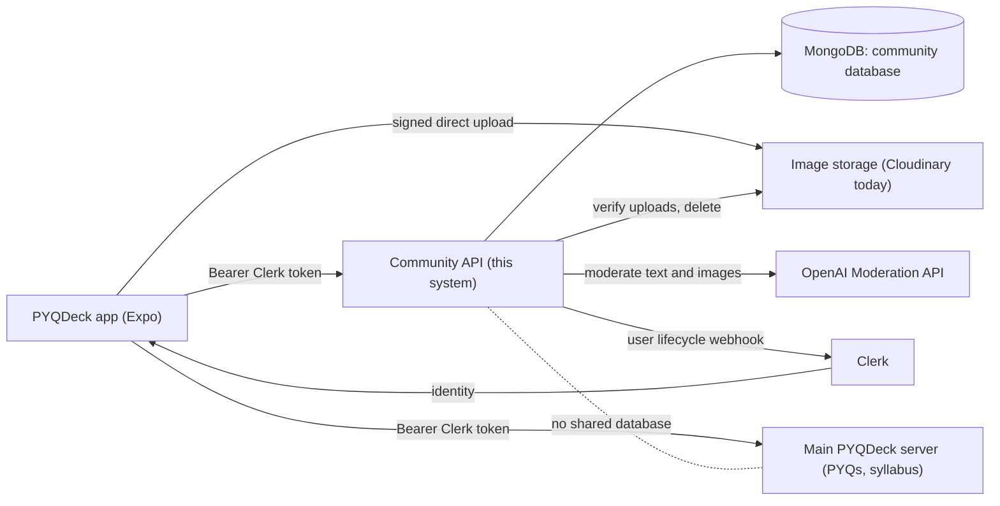
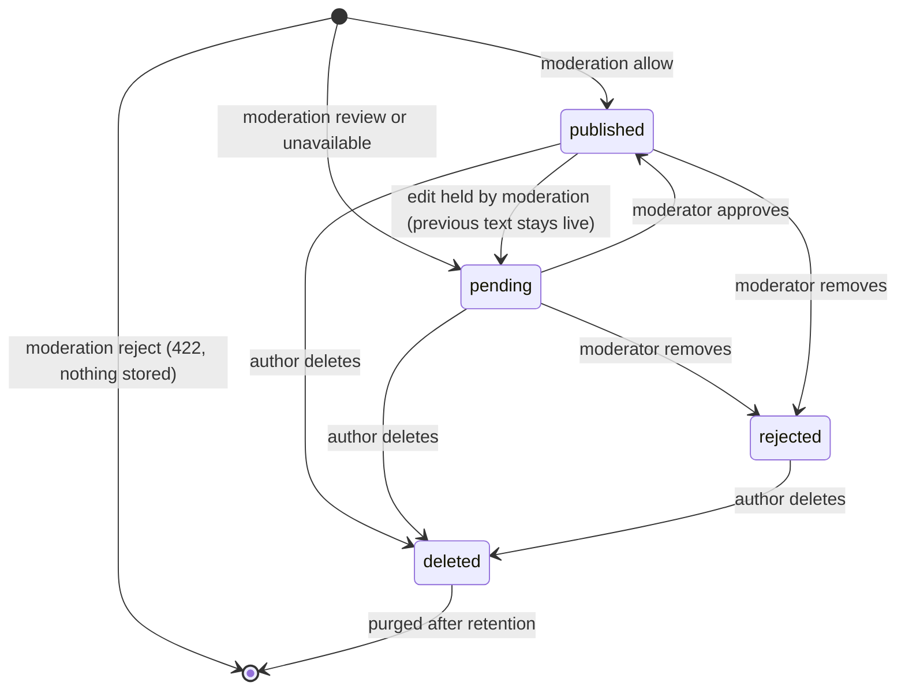

# Software Requirements Specification: PYQDeck Community Service

Structured after ISO/IEC/IEEE 29148:2018 (Systems and software engineering — Life cycle processes — Requirements
engineering), which supersedes IEEE Std 830-1998. Requirement attributes follow clause 5.2.5 of that standard.

| Field            | Value                                                                                                                             |
| ---------------- | --------------------------------------------------------------------------------------------------------------------------------- |
| System           | PYQDeck Community Service (`pyqdeck-community`) and its client SDK                                                                |
| Client           | PYQDeck mobile app (`pyqdeck-expo`)                                                                                               |
| Document version | 1.0 (draft for review)                                                                                                            |
| Date             | 2026-10-17                                                                                                                        |
| Status           | Draft. Reverse-engineered from the Expo app's mock community feature, plus owner decisions recorded in section 1.2 and Appendix E |
| Audience         | Product owner, backend and app developers, QA, reviewers                                                                          |

**Requirement conventions.** IDs use the team's existing prefixes: `FR-` functional, `NFR-` non-functional,
`IR-` interface, `CR-` constraint. Priority is MoSCoW (**M** must, **S** should, **C** could). Every requirement is
phrased with "shall" and is meant to be singular and testable. **Source** says where it came from: `App:` a behaviour
observed in `pyqdeck-expo` (file named), `Owner:` a decision by the product owner, `Proposed:` introduced here because
the app does not yet cover it. **Status** is the state of the backend today: `Built`, `Partial`, `Not built`.
**V** is the verification method: **T** test, **I** inspection, **D** demonstration, **A** analysis. Items marked
**TBD-n** need a decision; they are listed with recommendations in Appendix E.

---

## 1. Introduction

### 1.1 Purpose

This document specifies the requirements for the PYQDeck Community Service: the backend that replaces the in-memory
mock (`src/data/mockCommunity.ts`, `src/services/userProfileService.ts`) behind the community features of the PYQDeck
app. It is the reference for design, implementation, test and acceptance of the service and of the client SDK that the
app will use to call it.

### 1.2 Scope

PYQDeck is a study companion for students of Bihar Engineering University (BEU). The **main server**
(`D:\projects\PYQDECK\server`) owns previous-year papers, syllabus and notes. The **Community Service** specified
here is a separate server and database that adds a LinkedIn-style social space for the same students.

**In scope (this release)**

- Profiles (community-side data on top of a Clerk identity).
- Posts: Markdown/LaTeX text, `#hashtags`, **images**, an optional link to a PYQ or syllabus topic.
- **Editing and deleting** one's own posts and comments.
- Comments with replies, likes on posts and comments, bookmarks.
- Follow / unfollow.
- Feed, hashtag filtering, trending hashtags, search.
- Activity notifications (comments, replies, likes, follows, moderation outcomes).
- Automated content moderation, user reports, blocking, a moderator workflow and an audit trail.
- Image storage across pluggable provider accounts, with failover.
- A TypeScript client SDK.

**Out of scope (this release)**

- **PDF and other document attachments.** Owner decision: images only for now. The app's document-slide UI
  (`CommunityDocumentSlide`) and `pdf` attachment type stay mock-only until a later phase (see TBD-3).
- **Direct messages.** The app shows "Direct messaging … will be available in the upcoming peer study update"
  (`UserProfileScreen.tsx`); the inbox's message items are mock data. Notification type `message` is reserved only.
- University notices ("BEU Exam Notice", type `system`): produced by the main server's admin tooling, not by this
  service (TBD-8).
- Advertisements: the app inserts inline ads client-side from main-server flags and the viewer's ad-free entitlement
  (`CommunityFeedScreen.tsx`). The Community Service neither serves nor tracks ads.
- Sign-up, sign-in, passwords and tokens: owned by Clerk.

### 1.3 Product overview

#### 1.3.1 Product perspective

The Community Service shares **only** the Clerk identity with the main server. It has its own database. References to
main-server content (a PYQ or topic) are stored as opaque identifiers and resolved by the app (TBD-9).

#### 1.3.2 Product functions

Authenticate via Clerk; maintain profiles; create, edit, delete and read posts; comment and reply; react and bookmark;
follow; search and filter; notify; moderate (automatically and by humans); store images; expose all of this through a
documented REST API and a TypeScript SDK.

#### 1.3.3 User characteristics

| Role         | Description                                                        |
| ------------ | ------------------------------------------------------------------ |
| Visitor      | Not signed in. May read public content (TBD-1).                    |
| Member       | Signed-in student. Default role. Creates content, follows, reacts. |
| Moderator    | Trusted member who reviews reports and held content.               |
| Admin        | Operates the service: storage accounts, roles, suspensions.        |
| SDK consumer | A developer integrating the SDK in the app.                        |

Members are mostly students on mid-range Android phones with variable mobile connectivity, writing in English with
occasional Hindi. Content is exam-focused and includes mathematics (LaTeX).

#### 1.3.4 Limitations

- Identity fields (name, username, avatar, email) are owned by Clerk and cannot be edited through this service.
- Image storage uses third-party free tiers that can run out; the system must keep working by moving to another account.
- Automated moderation depends on an external API and is probabilistic; it cannot replace human review.

### 1.4 Definitions

| Term     | Meaning                                                                                                 |
| -------- | ------------------------------------------------------------------------------------------------------- |
| Post     | A member's published item: text, optional images, optional linked resource.                             |
| Comment  | A response to a post. A reply is a comment on a comment; replies display one level deep (see FR-CMT-3). |
| Held     | Content not published, waiting for a moderator (post status `pending`).                                 |
| Removed  | Content taken down by a moderator (post status `rejected`).                                             |
| Deleted  | Content removed by its author.                                                                          |
| Handle   | The public username used in profile URLs.                                                               |
| Ticket   | A short-lived, signed instruction that lets the app upload a file straight to the storage provider.     |
| Escalate | Flag on moderation events involving sexual content with minors, requiring a human and legal process.    |

---

## 2. References

1. ISO/IEC/IEEE 29148:2018, _Systems and software engineering — Life cycle processes — Requirements engineering_.
2. `pyqdeck-expo/docs/SRS-community.md` v2.0 (UI-level description of the shipped mock).
3. `pyqdeck-expo/docs/SRS-pyqdeck-app.md` (main app SRS; naming and ID conventions).
4. `pyqdeck-expo/docs/client-abuse-handling-plan.md` (client-side search guards; reused in FR-SRCH).
5. Source files observed: `src/types/community.ts`, `src/data/mockCommunity.ts`, `src/services/userProfileService.ts`,
   `src/screens/{CommunityFeedScreen,CommunityPostDetailScreen,UserProfileScreen,ActivityInboxScreen}.tsx`,
   `src/components/community/*`, `src/components/profile/EditProfileModal.tsx`, `src/api/index.ts`, `App.tsx`.
6. `pyqdeck-community/README.md`, `AGENTS.md`, and the OpenAPI document served at `/api/docs/json`.
7. OpenAI Moderation API guide: <https://developers.openai.com/api/docs/guides/moderation>.
8. Google Play _User Generated Content_ policy and Apple App Store Review Guideline 1.2 (user-generated content).
   Wording must be re-checked at release time (NFR-COMP-1).

---

## 3. Specific requirements

### 3.1 External interfaces

#### 3.1.1 User interfaces

The service has no UI of its own. The app's existing screens define the behaviour the API must support: Community feed,
post composer, post detail, comments sheet, user profile and edit-profile modal, Activity/inbox, hashtag filter bar,
and share/report menus. Screen-level layout is specified in `SRS-community.md` and is not repeated here.

#### 3.1.2 Hardware interfaces

None.

#### 3.1.3 Software interfaces

| ID      | Requirement                                                                                                                                               | Pri | Source                              | Status | V   |
| ------- | --------------------------------------------------------------------------------------------------------------------------------------------------------- | --- | ----------------------------------- | ------ | --- |
| IR-SW-1 | The system shall verify identity using Clerk session tokens issued to the same Clerk instance as the main server.                                         | M   | App: `api/index.ts` (Bearer tokens) | Built  | T   |
| IR-SW-2 | The system shall receive Clerk user lifecycle events (`user.created`, `user.updated`, `user.deleted`) on a Svix-signed webhook dedicated to this service. | M   | Proposed                            | Built  | T   |
| IR-SW-3 | The system shall store images through a provider-independent storage interface; Cloudinary shall be the first provider.                                   | M   | Owner                               | Built  | T   |
| IR-SW-4 | The system shall call the OpenAI Moderation API (`omni-moderation-latest`) for text and image moderation.                                                 | M   | Owner                               | Built  | T   |
| IR-SW-5 | The system shall use a MongoDB database separate from the main server's.                                                                                  | M   | Proposed                            | Built  | I   |

#### 3.1.4 Communications interfaces

| ID        | Requirement                                                                                                                                                                                                                             | Pri | Source                                                                         | Status                        | V   |
| --------- | --------------------------------------------------------------------------------------------------------------------------------------------------------------------------------------------------------------------------------------- | --- | ------------------------------------------------------------------------------ | ----------------------------- | --- |
| IR-API-1  | The system shall expose a JSON REST API over HTTPS under a versioned prefix (`/api/v1`) (TBD-10).                                                                                                                                       | M   | Proposed                                                                       | Partial (`/api`, unversioned) | I   |
| IR-API-2  | Success responses shall have the form `{ "success": true, "data": … }`; list responses shall add a `pagination` object.                                                                                                                 | M   | Proposed                                                                       | Built                         | T   |
| IR-API-3  | Error responses shall have the form `{ "success": false, "message": string, "details"?: …, "requestId": string }` with a meaningful HTTP status.                                                                                        | M   | Proposed                                                                       | Built                         | T   |
| IR-API-4  | Every response shall carry an `x-request-id` header equal to `requestId` in error bodies.                                                                                                                                               | M   | Proposed                                                                       | Built                         | T   |
| IR-API-5  | Rate-limited responses shall use HTTP 429 and include a `Retry-After` header, which the app already honours (`api/index.ts`).                                                                                                           | M   | App                                                                            | Not built                     | T   |
| IR-API-6  | Timestamps shall be ISO 8601 UTC strings; the client formats relative times such as "2h".                                                                                                                                               | M   | App: mock uses "2h" strings                                                    | Built                         | I   |
| IR-API-7  | List endpoints for feeds, comments and notifications shall use cursor pagination so inserts during scrolling cause no duplicates or gaps.                                                                                               | M   | Proposed                                                                       | Not built (offset only)       | T   |
| IR-API-8  | The system shall publish an OpenAPI 3 document and Swagger UI outside production.                                                                                                                                                       | S   | Proposed                                                                       | Built                         | I   |
| IR-API-9  | The system shall be served from its own origin, separate from the main server's (production: `beu-community-api.pyqdeck.in`), and the SDK shall take its base URL from configuration so development, staging and production can differ. | M   | Owner                                                                          | Partial                       | I   |
| IR-API-10 | The SDK shall keep its own origin and failure handling and shall not share origin-health or failover state with the app's main API client, so a community outage cannot change which origin the main API uses.                          | M   | App: `api/backend.ts` fails over on 5xx                                        | Not built                     | T   |
| IR-API-11 | The SDK and the main API client shall use the same Clerk token, supplied through one `getToken()` source.                                                                                                                               | M   | App: `api/index.ts` Bearer tokens                                              | Not built                     | I   |
| IR-SDK-1  | The system shall ship a TypeScript SDK exposing every endpoint used by the app with typed requests, responses and errors.                                                                                                               | M   | Owner                                                                          | Not built                     | T   |
| IR-SDK-2  | The SDK shall receive the Clerk token through an injected `getToken()` function and shall not depend on Clerk or React in its core.                                                                                                     | M   | Proposed                                                                       | Not built                     | I   |
| IR-SDK-3  | The SDK shall expose upload progress (0 to 1) and cancellation (`AbortSignal`) for post publishing, matching `PendingPostUpload.progress` and the cancel action in the app.                                                             | M   | App: `PendingPostCard`, `mockCommunity.ts`                                     | Not built                     | D   |
| IR-SDK-4  | The SDK shall perform the direct-upload sequence (request tickets, upload, complete) as one operation.                                                                                                                                  | M   | Owner                                                                          | Not built                     | T   |
| IR-SDK-5  | The SDK shall surface `Retry-After` and a stable error `code`/status so the app can show cooldowns as it does for search.                                                                                                               | S   | App: `client-abuse-handling-plan.md`                                           | Not built                     | T   |
| IR-SDK-6  | The SDK shall run on Hermes (Android) without `AbortSignal.timeout` and shall use `XHR` or an equivalent where upload progress is needed.                                                                                               | M   | App: `api/index.ts` comments                                                   | Not built                     | T   |
| IR-SDK-7  | The SDK shall be generated from, or type-checked against, the OpenAPI document so that contract drift fails CI.                                                                                                                         | S   | Proposed                                                                       | Not built                     | I   |
| IR-SDK-8  | The SDK shall export stable query-key factories (for example `communityKeys.feed(filters)`, `.post(id)`, `.comments(postId)`) so the app can cache and invalidate with TanStack Query without hand-building keys.                       | M   | App: `@tanstack/react-query` in `api/queries.ts`; `SRS-unified-cache-layer.md` | Not built                     | I   |
| IR-SDK-9  | The SDK shall return only JSON-serialisable values (dates as ISO strings, no class instances, `Map` or `Set`) so responses can be persisted by the app's AsyncStorage query persister.                                                  | M   | App: `query-async-storage-persister`                                           | Not built                     | T   |
| IR-SDK-10 | The SDK shall accept an `AbortSignal` on every request and throw typed errors carrying `status`, a stable `code` and `retryAfterMs`, so the app can pass TanStack Query's `signal` and decide retries.                                  | M   | App: TanStack `queryFn({ signal })`; `api/index.ts`                            | Not built                     | T   |
| IR-SDK-11 | The SDK shall not hold a cache of its own; caching, retries and optimistic updates shall remain the responsibility of the consuming app.                                                                                                | M   | Owner                                                                          | Not built                     | I   |

### 3.2 Functional requirements

#### 3.2.1 Identity and access (FR-AUTH)

| ID        | Requirement                                                                                                                   | Pri | Source                        | Status  | V   |
| --------- | ----------------------------------------------------------------------------------------------------------------------------- | --- | ----------------------------- | ------- | --- |
| FR-AUTH-1 | The system shall treat a request as signed in only when it carries a valid Clerk session token.                               | M   | App                           | Built   | T   |
| FR-AUTH-2 | The system shall create the member's community profile on their first authenticated request.                                  | M   | Proposed                      | Built   | T   |
| FR-AUTH-3 | The system shall copy name, username, avatar and email from Clerk and shall not allow them to be changed through its API.     | M   | Owner                         | Built   | T   |
| FR-AUTH-4 | The system shall keep a username reserved for staff (for example `admin`, `support`) from being adopted as a handle.          | M   | Proposed                      | Built   | T   |
| FR-AUTH-5 | The system shall reject write requests from suspended members with HTTP 403 and from deleted members with HTTP 401.           | M   | Proposed                      | Built   | T   |
| FR-AUTH-6 | The system shall grant the `admin` role only to verified Clerk emails on an allow-list.                                       | M   | Proposed                      | Built   | T   |
| FR-AUTH-7 | The system shall allow anonymous reading of public content: feed, post, comments, public profiles, trending hashtags (TBD-1). | S   | App: anonymous-first main app | Partial | T   |
| FR-AUTH-8 | The system shall require sign-in for every write action (post, comment, react, bookmark, follow, report, block).              | M   | App                           | Built   | T   |
| FR-AUTH-9 | The system shall make the member's `role` visible in public profiles and shall never infer staff status from a username.      | M   | Proposed                      | Built   | T   |

#### 3.2.2 Profiles (FR-PRF)

Field mapping to the app's `UserProfileData`: the app's `bio` is a one-line headline and `about` is the long
description. The service stores them as `headline` and `bio` respectively (the SDK performs the renaming, Appendix D).

| ID        | Requirement                                                                                                                                                                                                                          | Pri | Source                                        | Status                       | V   |
| --------- | ------------------------------------------------------------------------------------------------------------------------------------------------------------------------------------------------------------------------------------ | --- | --------------------------------------------- | ---------------------------- | --- |
| FR-PRF-1  | The system shall return the signed-in member's own profile, including private fields (email, status), at a fixed path (`/users/me`).                                                                                                 | M   | App: `getProfile('me')`                       | Built                        | T   |
| FR-PRF-2  | The system shall return any member's public profile by handle and shall never include email, Clerk id or status.                                                                                                                     | M   | App: `UserProfileScreen`                      | Built                        | T   |
| FR-PRF-3  | The system shall let a member update `headline` (≤ 120 chars), `bio` (≤ 500), `college`, `branch`, `semester`, `gradYear`, `location` (≤ 80), `github`, `linkedin`, `twitter`, `website` and `skills` (≤ 10 items, ≤ 30 chars each). | M   | App: `EditProfileModal`                       | Partial (headline, bio only) | T   |
| FR-PRF-4  | The system shall accept social links as handles for GitHub, LinkedIn and Twitter/X and as an `https` URL for `website`, and shall reject any other URL scheme (including `javascript:` and `intent:`).                               | M   | App: `Linking.openURL` in `UserProfileScreen` | Not built                    | T   |
| FR-PRF-5  | The system shall store a cover image produced through the media pipeline (FR-MED) and shall allow it to be removed.                                                                                                                  | S   | App: cover banner in `EditProfileModal`       | Not built                    | T   |
| FR-PRF-6  | The system shall treat the avatar as Clerk-owned: changing it shall be done in Clerk and re-synced by webhook (TBD-4).                                                                                                               | M   | Owner                                         | Built (sync)                 | T   |
| FR-PRF-7  | The system shall compute and return `followersCount`, `followingCount`, `postsCount` (the app's `contributionsCount`) and `upvotesCount` (likes received on the member's published posts).                                           | M   | App: `UserProfileData`                        | Not built                    | T   |
| FR-PRF-8  | The system shall return `isFollowing` for the viewer on another member's profile.                                                                                                                                                    | M   | App                                           | Not built                    | T   |
| FR-PRF-9  | The system shall list a member's published posts (Posts tab) with cursor pagination.                                                                                                                                                 | M   | App: `UserProfileScreen`                      | Not built                    | T   |
| FR-PRF-10 | The system shall list the signed-in member's bookmarked posts (Saved tab) and shall keep this list private to them.                                                                                                                  | M   | App: `UserProfileScreen`                      | Not built                    | T   |
| FR-PRF-11 | The system shall validate `college` and `branch` against the reference lists the app bundles (`data/colleges.ts`, `data/branches.ts`) (TBD-7).                                                                                       | S   | App                                           | Not built                    | T   |
| FR-PRF-12 | The system shall moderate all free-text profile fields (headline, bio, location, skills) before saving them.                                                                                                                         | M   | Proposed                                      | Not built                    | T   |
| FR-PRF-13 | The system shall return `404` for deleted members' profiles.                                                                                                                                                                         | M   | Proposed                                      | Built                        | T   |

#### 3.2.3 Follow graph (FR-FLW)

| ID       | Requirement                                                                                                                        | Pri | Source                       | Status    | V   |
| -------- | ---------------------------------------------------------------------------------------------------------------------------------- | --- | ---------------------------- | --------- | --- |
| FR-FLW-1 | The system shall let a member follow another member and shall make repeating the action harmless (idempotent).                     | M   | App: `toggleFollowUser`      | Not built | T   |
| FR-FLW-2 | The system shall let a member unfollow and shall make repeating the action harmless.                                               | M   | App                          | Not built | T   |
| FR-FLW-3 | The system shall refuse a request to follow oneself.                                                                               | M   | Proposed                     | Not built | T   |
| FR-FLW-4 | The system shall keep follower and following counts consistent with the actual relationships, including under concurrent requests. | M   | Proposed                     | Not built | T   |
| FR-FLW-5 | The system shall create a `follow` notification for the followed member (FR-NTF-2).                                                | M   | App: Activity "followed you" | Not built | T   |
| FR-FLW-6 | The system shall list a member's followers and following with cursor pagination.                                                   | C   | Proposed                     | Not built | T   |
| FR-FLW-7 | The system shall remove follow relationships between two members when either blocks the other (FR-BLK-1).                          | M   | Proposed                     | Not built | T   |

#### 3.2.4 Posts (FR-POST)

A post's text is Markdown with LaTeX math (`**bold**`, `$x$`, `$$…$$`), observed in the mock content. The service stores
the text as given and never renders or executes it; clients render it.

| ID         | Requirement                                                                                                                                                                                                                      | Pri | Source                                                     | Status                             | V   |
| ---------- | -------------------------------------------------------------------------------------------------------------------------------------------------------------------------------------------------------------------------------- | --- | ---------------------------------------------------------- | ---------------------------------- | --- |
| FR-POST-1  | The system shall let a signed-in member create a post containing text, images, or both, and shall reject a post with neither.                                                                                                    | M   | App: "Empty Post" check in `CreateCommunityPostModal`      | Not built                          | T   |
| FR-POST-2  | The system shall limit post text to 5,000 characters (TBD-5).                                                                                                                                                                    | M   | Proposed (UI shows a counter, no limit)                    | Not built                          | T   |
| FR-POST-3  | The system shall accept 1 to 8 images per post (TBD-2: the app currently caps at 5).                                                                                                                                             | M   | Owner                                                      | Partial (media: 8)                 | T   |
| FR-POST-4  | The system shall extract hashtags from the text using the pattern `#[A-Za-z0-9_-]+`, de-duplicate them case-insensitively, keep the first spelling, and keep at most 10.                                                         | M   | App: `handleSubmit` regex                                  | Not built                          | T   |
| FR-POST-5  | The system shall store an optional linked resource `{ type: 'pyq' \| 'topic', title, subtitle?, subjectId?, semesterId?, year?, questionId?, topicId? }` and shall not validate its identifiers against the main server (TBD-9). | S   | App: `CommunityLinkedResource`                             | Not built                          | T   |
| FR-POST-6  | The system shall give every post a unique, immutable, human-readable `slug` and shall resolve a post by id or slug.                                                                                                              | M   | App: `getPostById(idOrSlug)`, deep link `/community/:slug` | Not built                          | T   |
| FR-POST-7  | The system shall set post visibility to public; other audiences are not supported in this release.                                                                                                                               | M   | App: "Anyone" pill                                         | Not built                          | I   |
| FR-POST-8  | The system shall set a new post's status from moderation: `allow` gives `published`, `review` gives `pending`, `reject` shall refuse creation with HTTP 422 and an explanation.                                                  | M   | App: `CommunityPostStatus`; Owner                          | Not built                          | T   |
| FR-POST-9  | The system shall never publish a post when moderation could not be completed; it shall hold it as `pending` (or ask the client to retry).                                                                                        | M   | Proposed                                                   | Partial (service built, posts not) | T   |
| FR-POST-10 | The system shall let the author **edit** their post's text, linked resource and images.                                                                                                                                          | M   | Owner                                                      | Not built                          | T   |
| FR-POST-11 | The system shall re-moderate edited content before it replaces the published version, and shall keep the previous published version live until the edit passes.                                                                  | M   | Owner; Proposed                                            | Not built                          | T   |
| FR-POST-12 | The system shall record `editedAt` on edited posts and expose it so clients can show an "edited" label (edit window and history: TBD-16).                                                                                        | M   | Proposed                                                   | Not built                          | T   |
| FR-POST-13 | The system shall allow an edit only by the author; moderators shall remove content through moderation, not by editing it.                                                                                                        | M   | Proposed                                                   | Not built                          | T   |
| FR-POST-14 | The system shall let the author **delete** their post, making it disappear immediately from every feed, profile, search result and share link (HTTP 404).                                                                        | M   | Owner                                                      | Not built                          | T   |
| FR-POST-15 | The system shall, when a post is deleted, delete its image files from storage and release their storage quota.                                                                                                                   | M   | Owner                                                      | Partial (media release built)      | T   |
| FR-POST-16 | The system shall, when a post is deleted, hide its comments and remove notifications that point to it.                                                                                                                           | M   | Owner                                                      | Not built                          | T   |
| FR-POST-17 | The system shall keep a deleted post's record (soft delete) for 30 days for abuse investigation and then purge it (TBD-6).                                                                                                       | S   | Proposed                                                   | Not built                          | T   |
| FR-POST-18 | The system shall return a single post with counts (`likesCount`, `commentsCount`, `bookmarksCount`) and the viewer's `isLiked`, `isBookmarked` and `isOwnPost`.                                                                  | M   | App: `CommunityPost`                                       | Not built                          | T   |
| FR-POST-19 | The system shall show a member their own `pending` and `rejected` posts, with the reason, and shall hide them from everyone else.                                                                                                | M   | App: `status` field and `isOwnPost`                        | Not built                          | T   |
| FR-POST-20 | The system shall let a member hide a post from their own feed ("Post removed — Hidden from your feed") and shall remember this across sessions.                                                                                  | M   | App: `dismissPost` in `CommunityPostCard`                  | Not built                          | T   |
| FR-POST-21 | The system shall allow a member to undo hiding a post.                                                                                                                                                                           | C   | Proposed                                                   | Not built                          | T   |

#### 3.2.5 Feed, hashtags and search (FR-FEED, FR-SRCH)

| ID        | Requirement                                                                                                                                                   | Pri | Source                                          | Status    | V   |
| --------- | ------------------------------------------------------------------------------------------------------------------------------------------------------------- | --- | ----------------------------------------------- | --------- | --- |
| FR-FEED-1 | The system shall return published posts newest first with cursor pagination (default 20, maximum 50 per page).                                                | M   | App: `FlatList` feed                            | Not built | T   |
| FR-FEED-2 | The system shall filter the feed by hashtag, case-insensitively.                                                                                              | M   | App: `selectedHashtag` filter                   | Not built | T   |
| FR-FEED-3 | The system shall exclude from a viewer's feed posts they hid, posts by members they blocked or who blocked them, and posts by suspended or deleted members.   | M   | App: dismiss; Proposed                          | Not built | T   |
| FR-FEED-4 | The system shall include the viewer's own `pending` posts in their own feed responses only.                                                                   | M   | App: pending card                               | Not built | T   |
| FR-FEED-5 | The system shall return trending hashtags: the top 10 by number of distinct published posts in the last 7 days, refreshed at least every 10 minutes (TBD-11). | S   | App: `trendingHashtags` in `CommunityFilterBar` | Not built | T   |
| FR-FEED-6 | The system shall return a pull-to-refresh-safe first page, so refreshing never loses newer posts.                                                             | M   | App: `RefreshControl`                           | Not built | T   |
| FR-SRCH-1 | The system shall search published posts by text and hashtags, as the app's search box does ("Search posts, doubts, #tags…").                                  | M   | App: `CommunityFeedScreen`                      | Not built | T   |
| FR-SRCH-2 | The system shall reject a search shorter than 2 or longer than 100 characters, or containing no letter or digit, with HTTP 400.                               | M   | App: `client-abuse-handling-plan.md`            | Not built | T   |
| FR-SRCH-3 | The system shall apply the same visibility exclusions to search as to the feed (FR-FEED-3).                                                                   | M   | Proposed                                        | Not built | T   |
| FR-SRCH-4 | The system shall search members by handle and display name.                                                                                                   | C   | Proposed                                        | Not built | T   |

#### 3.2.6 Comments (FR-CMT)

The app shows a comment and its replies as two levels; a reply to a reply attaches to the original comment with an
`@name` mention (`CommunityCommentsBottomSheet`, `replyToAuthorName`), and replies are collapsed until expanded.

| ID        | Requirement                                                                                                                                                                                                 | Pri | Source                                    | Status    | V   |
| --------- | ----------------------------------------------------------------------------------------------------------------------------------------------------------------------------------------------------------- | --- | ----------------------------------------- | --------- | --- |
| FR-CMT-1  | The system shall let a signed-in member comment on a published post with text of 1 to 1,000 characters (TBD-5).                                                                                             | M   | App: `addComment`                         | Not built | T   |
| FR-CMT-2  | The system shall list a post's top-level comments, oldest first, with each comment's `repliesCount`, `likesCount` and the viewer's `isLiked`, using cursor pagination.                                      | M   | App: `getComments`                        | Not built | T   |
| FR-CMT-3  | The system shall always attach a reply to the top-level comment of its thread: a reply to a reply shall be stored under the same top-level comment and carry the replied-to member for the `@name` mention. | M   | App: `replyToAuthorName`, `rootCommentId` | Not built | T   |
| FR-CMT-4  | The system shall list the replies of a comment on request, oldest first, with cursor pagination.                                                                                                            | M   | App: `expandedReplyThreads`               | Not built | T   |
| FR-CMT-5  | The system shall keep the post's `commentsCount` equal to the number of its visible comments and replies.                                                                                                   | M   | App: count increments                     | Not built | T   |
| FR-CMT-6  | The system shall let a member **delete** their own comment; deleting a top-level comment shall remove its replies from view.                                                                                | M   | Owner                                     | Not built | T   |
| FR-CMT-7  | The system shall let a member **edit** their own comment, re-moderate the new text, and mark it as edited.                                                                                                  | S   | Owner                                     | Not built | T   |
| FR-CMT-8  | The system shall let the post's author and moderators delete comments on that post.                                                                                                                         | S   | Proposed                                  | Not built | T   |
| FR-CMT-9  | The system shall moderate every comment before it becomes visible and shall refuse a rejected comment with HTTP 422.                                                                                        | M   | Proposed                                  | Not built | T   |
| FR-CMT-10 | The system shall create a `comment` notification for the post's author and a `reply` notification for the replied-to member (FR-NTF-2).                                                                     | M   | App: Activity "comment"                   | Not built | T   |

#### 3.2.7 Reactions and bookmarks (FR-REACT)

| ID         | Requirement                                                                                                                                             | Pri | Source                    | Status    | V   |
| ---------- | ------------------------------------------------------------------------------------------------------------------------------------------------------- | --- | ------------------------- | --------- | --- |
| FR-REACT-1 | The system shall let a member like (upvote) a published post and shall allow at most one like per member per post, including under concurrent requests. | M   | App: `toggleLikePost`     | Not built | T   |
| FR-REACT-2 | The system shall let a member remove their like and shall make repeating either action harmless.                                                        | M   | App                       | Not built | T   |
| FR-REACT-3 | The system shall let a member like and unlike a comment under the same rules.                                                                           | M   | App: `toggleLikeComment`  | Not built | T   |
| FR-REACT-4 | The system shall let a member bookmark and unbookmark a post under the same rules.                                                                      | M   | App: `toggleBookmarkPost` | Not built | T   |
| FR-REACT-5 | The system shall keep `likesCount` and `bookmarksCount` equal to the actual number of records and never negative.                                       | M   | App: `Math.max(0, …)`     | Not built | T   |
| FR-REACT-6 | The system shall not notify a member about their own like.                                                                                              | M   | Proposed                  | Not built | T   |
| FR-REACT-7 | The system shall refuse reactions on posts that are not published, deleted, or by members who blocked the viewer.                                       | M   | Proposed                  | Not built | T   |

#### 3.2.8 Notifications / Activity (FR-NTF)

The inbox filters are All, Unread, Messages and Activity (`ActivityInboxScreen`). Messages are out of scope; the
"upvote" item reads "received 14 new upvotes", so like notifications are aggregated.

| ID        | Requirement                                                                                                                                                                                       | Pri | Source                         | Status    | V   |
| --------- | ------------------------------------------------------------------------------------------------------------------------------------------------------------------------------------------------- | --- | ------------------------------ | --------- | --- |
| FR-NTF-1  | The system shall list the signed-in member's notifications newest first with cursor pagination and shall support filtering by unread and by type.                                                 | M   | App: filter chips              | Not built | T   |
| FR-NTF-2  | The system shall generate notifications of types `comment`, `reply`, `upvote`, `follow` and `moderation`, each with actor, target (post, comment or member), title, body, `read` and `createdAt`. | M   | App: `UnifiedNotificationItem` | Not built | T   |
| FR-NTF-3  | The system shall aggregate likes on the same post into a single notification updated at most once per 10 minutes ("received N new upvotes").                                                      | M   | App: aggregated upvote item    | Not built | T   |
| FR-NTF-4  | The system shall never create a notification for a member's own action.                                                                                                                           | M   | Proposed                       | Not built | T   |
| FR-NTF-5  | The system shall mark one notification read and shall mark all of a member's notifications read in one request.                                                                                   | M   | App: "Mark all as read"        | Not built | T   |
| FR-NTF-6  | The system shall return the unread count so the tab badge reflects real data (it is hard-coded to `3` today).                                                                                     | M   | App: `App.tsx` `tabBarBadge`   | Not built | T   |
| FR-NTF-7  | The system shall let a member dismiss a notification persistently (swipe-to-dismiss).                                                                                                             | M   | App: `SwipeableDismissItem`    | Not built | T   |
| FR-NTF-8  | The system shall notify an author when their post or comment is held or removed by moderation, with the reason category and without quoting the content.                                          | M   | Owner; Proposed                | Not built | T   |
| FR-NTF-9  | The system shall create no notification for, and remove notifications about, content that was deleted or became invisible to the recipient (deleted, blocked).                                    | M   | Proposed                       | Not built | T   |
| FR-NTF-10 | The system shall deliver push notifications for selected types through the existing push mechanism (TBD-12).                                                                                      | C   | App: push in main app          | Not built | D   |

#### 3.2.9 Media (FR-MED)

This area is largely built. Images only in this release.

| ID        | Requirement                                                                                                                                                                                                 | Pri | Source              | Status    | V   |
| --------- | ----------------------------------------------------------------------------------------------------------------------------------------------------------------------------------------------------------- | --- | ------------------- | --------- | --- |
| FR-MED-1  | The system shall accept only JPEG, PNG and WebP images, up to 8 MB each, deciding the type from the file's bytes and not from its name or declared type.                                                    | M   | Owner               | Built     | T   |
| FR-MED-2  | The system shall reject PDFs and all other document types.                                                                                                                                                  | M   | Owner (images only) | Built     | T   |
| FR-MED-3  | The system shall support direct upload from the app to the storage provider using a signed ticket, and shall verify the stored file before making it usable.                                                | M   | Owner               | Built     | T   |
| FR-MED-4  | The system shall also accept images through the API (multipart) as a fallback.                                                                                                                              | S   | Proposed            | Built     | T   |
| FR-MED-5  | The system shall moderate every image before it becomes usable, and shall delete a rejected image from storage.                                                                                             | M   | Owner               | Built     | T   |
| FR-MED-6  | The system shall limit a member to 16 unfinished upload tickets at a time.                                                                                                                                  | M   | Proposed            | Built     | T   |
| FR-MED-7  | The system shall delete uploads that are never attached to a post (after 1 hour) or never completed (after 65 minutes).                                                                                     | M   | Proposed            | Built     | T   |
| FR-MED-8  | The system shall spread files over any number of storage accounts, filling them in priority order, and shall fail over automatically to the next account when one is full.                                  | M   | Owner               | Built     | T   |
| FR-MED-9  | The system shall let an admin add, list, disable and re-prioritise storage accounts and refresh their real usage at runtime without redeploying; credentials shall be encrypted at rest and never returned. | M   | Owner               | Built     | T   |
| FR-MED-10 | The system shall let a member delete their own unattached upload, and staff delete any.                                                                                                                     | M   | Proposed            | Built     | T   |
| FR-MED-11 | The system shall extend the media pipeline to a second image purpose (profile cover) without changing the upload API.                                                                                       | S   | App: cover banner   | Not built | T   |
| FR-MED-12 | The system shall allow a later release to add document support by registering a new validator and provider capability, without changing existing endpoints (extensibility).                                 | C   | Owner (PDFs later)  | Partial   | I   |

#### 3.2.10 Moderation, reporting and blocking (FR-MOD, FR-RPT, FR-BLK)

| ID        | Requirement                                                                                                                                                                                                                            | Pri | Source                                     | Status                             | V   |
| --------- | -------------------------------------------------------------------------------------------------------------------------------------------------------------------------------------------------------------------------------------- | --- | ------------------------------------------ | ---------------------------------- | --- |
| FR-MOD-1  | The system shall check every text and image submitted by members (posts, edits, comments, profile text, images) with automated moderation before publishing it.                                                                        | M   | Owner                                      | Partial (service and images built) | T   |
| FR-MOD-2  | The system shall fail closed: when moderation is unavailable, content shall not be published.                                                                                                                                          | M   | Owner                                      | Built                              | T   |
| FR-MOD-3  | The system shall apply a configurable policy mapping each moderation category to reject, hold or ignore, plus a near-miss score that holds borderline content.                                                                         | M   | Owner                                      | Built                              | T   |
| FR-MOD-4  | The system shall record each held or rejected item (member, source, categories, scores, provider) without storing the content, and delete these events after 90 days.                                                                  | M   | Owner                                      | Built                              | T   |
| FR-MOD-5  | The system shall flag sexual content involving minors as `escalate`, log it at error level, and make it filterable for moderators.                                                                                                     | M   | Owner                                      | Built                              | T   |
| FR-MOD-6  | The system shall give moderators and admins a read-only list of moderation events with filters.                                                                                                                                        | M   | Proposed                                   | Built                              | T   |
| FR-MOD-7  | The system shall give moderators a queue of held (`pending`) posts and comments, with actions approve (publish), remove (status `rejected`) and, for posts, remove with reason.                                                        | M   | Proposed                                   | Not built                          | T   |
| FR-MOD-8  | The system shall let moderators and admins suspend and unsuspend a member and shall record who did it and why.                                                                                                                         | M   | Proposed                                   | Not built                          | T   |
| FR-MOD-9  | The system shall apply escalating consequences to repeated violations (strike policy) (TBD-13).                                                                                                                                        | S   | Proposed                                   | Not built                          | A   |
| FR-MOD-10 | The system shall let a member see why their content was held or removed and, for removals, request a review (appeal).                                                                                                                  | C   | Proposed                                   | Not built                          | D   |
| FR-RPT-1  | The system shall let a member report a post, a comment or a member, with a reason category (`spam`, `harassment`, `hate`, `sexual`, `violence`, `misinformation`, `other`) and an optional note of up to 300 characters.               | M   | App: Report post / comment / student menus | Not built                          | T   |
| FR-RPT-2  | The system shall accept at most one open report per reporter per target and shall tell the reporter it was received.                                                                                                                   | M   | App: confirmation dialogs                  | Not built                          | T   |
| FR-RPT-3  | The system shall list open reports for moderators, grouped by target with a count, and let a moderator close them with an outcome.                                                                                                     | M   | Proposed                                   | Not built                          | T   |
| FR-RPT-4  | The system shall hide a target automatically when it reaches a number of distinct reporters (TBD-13) until a moderator decides.                                                                                                        | S   | Proposed                                   | Not built                          | A   |
| FR-RPT-5  | The system shall not reveal the reporter's identity to the reported member.                                                                                                                                                            | M   | Proposed                                   | Not built                          | I   |
| FR-BLK-1  | The system shall let a member block and unblock another member; blocking shall hide each member's content and profile from the other and prevent follows, comments and reactions between them (what happens to existing data: TBD-17). | M   | Proposed (store policy; NFR-COMP-1)        | Not built                          | T   |
| FR-BLK-2  | The system shall list the members a member has blocked.                                                                                                                                                                                | S   | Proposed                                   | Not built                          | T   |

#### 3.2.11 Account lifecycle and administration (FR-ACC, FR-ADM)

| ID       | Requirement                                                                                                                           | Pri | Source   | Status    | V   |
| -------- | ------------------------------------------------------------------------------------------------------------------------------------- | --- | -------- | --------- | --- |
| FR-ACC-1 | The system shall, when a Clerk account is deleted, keep the member's row, remove their personal data, and free their handle.          | M   | Proposed | Built     | T   |
| FR-ACC-2 | The system shall decide, and apply consistently, what happens to a deleted member's posts and comments (anonymise or delete) (TBD-6). | M   | Proposed | Partial   | T   |
| FR-ACC-3 | The system shall show authors of deleted accounts as "Deleted user".                                                                  | M   | Proposed | Partial   | T   |
| FR-ADM-1 | The system shall let an admin grant and revoke the `moderator` role.                                                                  | M   | Proposed | Not built | T   |
| FR-ADM-2 | The system shall expose a health endpoint reporting service and database status.                                                      | M   | Proposed | Built     | T   |

### 3.3 Usability requirements

| ID        | Requirement                                                                                                                                                              | Pri | Source                      | Status    | V   |
| --------- | ------------------------------------------------------------------------------------------------------------------------------------------------------------------------ | --- | --------------------------- | --------- | --- |
| NFR-USE-1 | Validation errors shall name the offending field so the app can show an inline message.                                                                                  | M   | App: inline errors          | Built     | T   |
| NFR-USE-2 | Error `message` text shall be suitable for display to a student without technical detail; server faults shall never expose internals in production.                      | M   | Proposed                    | Built     | T   |
| NFR-USE-3 | A retried request after a timeout shall not create a duplicate post or comment (idempotency key) (TBD-14).                                                               | M   | App: flaky mobile networks  | Not built | T   |
| NFR-USE-4 | Share links shall be stable: `https://pyqdeck.in/community/{slug}` and `https://pyqdeck.in/community/u/{handle}` shall keep resolving for as long as the content exists. | M   | App: `linking` in `App.tsx` | Not built | T   |

### 3.4 Performance requirements

Targets are initial and shall be confirmed by measurement before release (**TBD-15**).

| ID         | Requirement                                                                                                                            | Pri | Source                     | Status    | V   |
| ---------- | -------------------------------------------------------------------------------------------------------------------------------------- | --- | -------------------------- | --------- | --- |
| NFR-PERF-1 | The server-side time to return a feed page of 20 posts shall be at most 400 ms at the 95th percentile with 100,000 posts.              | M   | Proposed                   | Not built | T   |
| NFR-PERF-2 | A text-only post shall be accepted, moderated and published within 2 s at the 95th percentile (the app's mock publishes in about 2 s). | M   | App: `startPostUpload` 2 s | Not built | T   |
| NFR-PERF-3 | A post with images shall be published within 3 s of the last image being confirmed at the 95th percentile (the mock uses 3 s).         | M   | App: `startPostUpload` 3 s | Not built | T   |
| NFR-PERF-4 | A like, bookmark or follow request shall complete within 300 ms at the 95th percentile.                                                | M   | App: optimistic toggles    | Not built | T   |
| NFR-PERF-5 | The system shall bound the moderation call at 8 s and retry once on transient failure.                                                 | M   | Owner                      | Built     | T   |
| NFR-PERF-6 | The system shall use indexed queries for every list endpoint (no collection scans on feed, comments, notifications, search).           | M   | Proposed                   | Not built | I   |
| NFR-PERF-7 | Counters (likes, comments, followers) shall be stored on the parent record and updated atomically, not computed per request.           | M   | Proposed                   | Not built | I   |

### 3.5 Logical database requirements

Entities of the community database. Fields shown are the logical model; physical details follow existing conventions
(Mongoose models, `createdAt`/`updatedAt`).

| Entity                                | Key fields                                                                                                                                                                                                                          | Constraints / notes                                                                                                         | Status    |
| ------------------------------------- | ----------------------------------------------------------------------------------------------------------------------------------------------------------------------------------------------------------------------------------- | --------------------------------------------------------------------------------------------------------------------------- | --------- |
| **User** (profile)                    | `clerkId`, `email` (private), `username`, `displayName`, `avatarUrl`, `headline`, `bio`, `college`, `branch`, `semester`, `gradYear`, `location`, social handles, `website`, `skills[]`, `coverMediaId`, counters, `role`, `status` | `clerkId` and `username` unique; role `member\|moderator\|admin`; status `active\|suspended\|deleted`                       | Partial   |
| **Post**                              | `authorId`, `slug`, `body`, `hashtags[]`, `mediaIds[]`, `linkedResource`, `status`, `likesCount`, `commentsCount`, `bookmarksCount`, `editedAt`, `deletedAt`                                                                        | `slug` unique; status `published\|pending\|rejected\|deleted`; index `(status, createdAt, _id)` and `(hashtags, createdAt)` | Not built |
| **Media**                             | `owner`, storage account/key/url, `mimeType`, `size`, `status`                                                                                                                                                                      | status `uploading\|pending\|attached`; stale rows purged                                                                    | Built     |
| **StorageAccount**                    | provider, encrypted credentials, capacity, usage, status, priority                                                                                                                                                                  | credentials never returned                                                                                                  | Built     |
| **Comment**                           | `postId`, `authorId`, `parentId` (top-level or null), `replyToUserId`, `body`, `likesCount`, `repliesCount`, `editedAt`, `deletedAt`                                                                                                | `parentId` always references a top-level comment                                                                            | Not built |
| **PostLike / CommentLike / Bookmark** | `userId`, target id                                                                                                                                                                                                                 | unique `(userId, target)`                                                                                                   | Not built |
| **Follow**                            | `followerId`, `followingId`                                                                                                                                                                                                         | unique pair; no self-follow                                                                                                 | Not built |
| **Block**                             | `blockerId`, `blockedId`                                                                                                                                                                                                            | unique pair                                                                                                                 | Not built |
| **HiddenPost**                        | `userId`, `postId`                                                                                                                                                                                                                  | unique pair                                                                                                                 | Not built |
| **Report**                            | `reporterId`, target type and id, reason, note, status, outcome, `resolvedBy`                                                                                                                                                       | one open report per reporter and target                                                                                     | Not built |
| **Notification**                      | `recipientId`, `type`, `actorId`, target ref, `read`, `dismissedAt`, `count`, `createdAt`                                                                                                                                           | index `(recipientId, createdAt)`                                                                                            | Not built |
| **ModerationEvent**                   | `userId`, `source`, `sourceId`, `action`, `categories`, `scores`, `escalate`, `degraded`, `provider`                                                                                                                                | no content stored; 90-day TTL                                                                                               | Built     |
| **Hashtag stats**                     | derived (or cached) top tags                                                                                                                                                                                                        | rebuilt periodically                                                                                                        | Not built |

### 3.6 Design constraints

| ID   | Requirement                                                                                                                                                                             | Pri | Source   | Status | V   |
| ---- | --------------------------------------------------------------------------------------------------------------------------------------------------------------------------------------- | --- | -------- | ------ | --- |
| CR-1 | The system shall be a TypeScript service on Express 5 and MongoDB (Mongoose), following the layered pattern in `AGENTS.md` (route, validation, controller, service, repository, model). | M   | Owner    | Built  | I   |
| CR-2 | The system shall use Clerk for identity; it shall not store credentials.                                                                                                                | M   | Owner    | Built  | I   |
| CR-3 | The system shall keep its database separate from the main server's and shall reference main-server content only by opaque id.                                                           | M   | Proposed | Built  | I   |
| CR-4 | The system shall depend on external providers (storage, moderation) only through interfaces that can be replaced by registering a new implementation.                                   | M   | Owner    | Built  | I   |
| CR-5 | The package manager shall be pnpm; CI shall run typecheck, lint, format check, tests and build.                                                                                         | M   | Owner    | Built  | I   |
| CR-6 | Every new module shall be documented in OpenAPI and covered by unit and integration tests.                                                                                              | M   | Proposed | Built  | I   |

### 3.7 Software system attributes

#### Reliability and availability

| ID        | Requirement                                                                                                                                                  | Pri | Source   | Status    | V   |
| --------- | ------------------------------------------------------------------------------------------------------------------------------------------------------------ | --- | -------- | --------- | --- |
| NFR-REL-1 | The system shall survive the failure of the storage or moderation provider without publishing unchecked content or losing accepted data.                     | M   | Owner    | Built     | T   |
| NFR-REL-2 | Operations that change several records (post with media, comment with counter) shall leave data consistent after any single failure, or be safely retryable. | M   | Proposed | Partial   | T   |
| NFR-REL-3 | The system shall target 99.5% monthly availability of read endpoints (TBD-15).                                                                               | S   | Proposed | Not built | A   |
| NFR-REL-4 | The system shall shut down gracefully, finishing in-flight requests and closing the database connection.                                                     | S   | Proposed | Built     | T   |

#### Security

| ID        | Requirement                                                                                                                                                                                                | Pri | Source                                 | Status    | V   |
| --------- | ---------------------------------------------------------------------------------------------------------------------------------------------------------------------------------------------------------- | --- | -------------------------------------- | --------- | --- |
| NFR-SEC-1 | The system shall enforce authorisation on the server for every action (ownership, role, block, suspension); the client shall never be trusted.                                                             | M   | Proposed                               | Partial   | T   |
| NFR-SEC-2 | The system shall rate-limit by member and by IP: for example posts 10/hour, comments 60/hour, likes 300/hour, reports 20/day, follows 100/hour (initial values, TBD-13), returning 429 with `Retry-After`. | M   | App: server has token-bucket; Proposed | Not built | T   |
| NFR-SEC-3 | The system shall treat all member text as untrusted data: never interpret it as HTML or code, and cap lengths.                                                                                             | M   | Proposed                               | Partial   | T   |
| NFR-SEC-4 | The system shall never log or store the moderated content, secrets, tokens or full request bodies.                                                                                                         | M   | Owner                                  | Built     | I   |
| NFR-SEC-5 | The system shall encrypt storage credentials at rest (AES-256-GCM) and refuse to start in production without the encryption and moderation keys.                                                           | M   | Owner                                  | Built     | T   |
| NFR-SEC-6 | The system shall verify webhook signatures before reading webhook bodies.                                                                                                                                  | M   | Proposed                               | Built     | T   |
| NFR-SEC-7 | The system shall restrict CORS to configured origins in production and send standard security headers.                                                                                                     | M   | Proposed                               | Built     | T   |
| NFR-SEC-8 | The system shall accept only `https` links for member-supplied URLs (FR-PRF-4).                                                                                                                            | M   | Proposed                               | Not built | T   |
| NFR-SEC-9 | The system shall return the same `404` for "not yours" and "does not exist" for private resources so identifiers cannot be probed.                                                                         | M   | Proposed                               | Partial   | T   |

#### Privacy and compliance

| ID         | Requirement                                                                                                                                                                                                                                                                                                                               | Pri | Source   | Status    | V   |
| ---------- | ----------------------------------------------------------------------------------------------------------------------------------------------------------------------------------------------------------------------------------------------------------------------------------------------------------------------------------------- | --- | -------- | --------- | --- |
| NFR-COMP-1 | The service and app shall satisfy the user-generated-content rules of Google Play and the Apple App Store at release: terms prohibiting objectionable content, automated filtering, an in-app report mechanism, the ability to block abusive users, timely action on reports, and published contact information (verify current wording). | M   | Proposed | Partial   | I   |
| NFR-COMP-2 | The system shall never expose a member's email, Clerk id or moderation history to other members.                                                                                                                                                                                                                                          | M   | Owner    | Built     | T   |
| NFR-COMP-3 | The system shall support deletion of a member's personal data on request or account deletion, within a defined period (TBD-6), consistent with India's Digital Personal Data Protection Act, 2023 (verify with counsel).                                                                                                                  | M   | Proposed | Partial   | A   |
| NFR-COMP-4 | The system shall define and document a process for content flagged `escalate` (review owner, evidence preservation, reporting route) before production launch.                                                                                                                                                                            | M   | Owner    | Not built | I   |

#### Maintainability, portability, observability

| ID        | Requirement                                                                                                                                     | Pri | Source   | Status  | V   |
| --------- | ----------------------------------------------------------------------------------------------------------------------------------------------- | --- | -------- | ------- | --- |
| NFR-MNT-1 | Policy rules (moderation categories, limits, rate limits) shall be configuration or a single table, changeable without touching business logic. | M   | Owner    | Partial | I   |
| NFR-MNT-2 | Automated tests shall cover every requirement marked **T**; unit tests shall run without a database or network.                                 | M   | Owner    | Partial | I   |
| NFR-OBS-1 | The system shall emit structured logs with a request id on every request and error.                                                             | M   | Owner    | Built   | I   |
| NFR-OBS-2 | The system shall expose moderation outcomes and storage utilisation to admins (counts, per-account usage percent).                              | S   | Owner    | Partial | D   |
| NFR-PRT-1 | The system shall run on Node.js 20 or later and be deployable as a container without local disk state.                                          | S   | Proposed | Partial | I   |

### 3.8 Supporting information

#### 3.8.1 Post status model

#### 3.8.2 Image upload and publish sequence

1. App requests tickets: `POST /media/uploads` (types and sizes only).
2. App uploads each file straight to the provider with its ticket.
3. App confirms each: `POST /media/{id}/complete`; the server inspects the file, moderates it, and marks it `pending`.
4. App creates the post with the confirmed media ids; the server moderates the text, then claims the media (`attached`).
5. On any failure the app can cancel; unclaimed uploads are removed automatically.

#### 3.8.3 Moderation decision table (default policy)

| Provider result                                                                                                                  | Action                  |
| -------------------------------------------------------------------------------------------------------------------------------- | ----------------------- |
| sexual, sexual/minors, hate, hate/threatening, harassment/threatening, violence/graphic, self-harm/instructions, illicit/violent | **Reject**              |
| harassment, violence, illicit, self-harm, self-harm/intent, or any unflagged category scoring ≥ 0.5                              | **Hold for review**     |
| provider unavailable or erroring                                                                                                 | **Hold; never publish** |
| image the provider cannot read                                                                                                   | **Reject**              |
| sexual/minors                                                                                                                    | Reject **and escalate** |

---

## 4. Verification

Each requirement carries a verification method (T, I, D, A). Acceptance of this specification requires:

| Level       | What                                                                               | How                                       |
| ----------- | ---------------------------------------------------------------------------------- | ----------------------------------------- |
| Unit        | Pure logic: policy, validators, cipher, pagination, ticket signing, failover       | `pnpm test:unit` (no database or network) |
| Integration | HTTP behaviour on an in-memory MongoDB with Clerk and providers faked              | `pnpm test`                               |
| Contract    | SDK types against the OpenAPI document; no breaking change without a version bump  | CI check (IR-SDK-7)                       |
| Security    | Authorisation matrix (role x ownership x block x suspension) for every endpoint    | Integration tests per endpoint            |
| Performance | NFR-PERF targets on a seeded dataset (100k posts, 500k comments)                   | Load test before release                  |
| Live smoke  | Real Clerk token, real Cloudinary upload and complete, real OpenAI moderation call | Manual script before release              |
| Compliance  | NFR-COMP checklist against current store policies                                  | Inspection by owner                       |

The automated test suite already covers the **Built** rows for authentication, storage, media and moderation. Every
new requirement marked **T** shall add tests in the same change that implements it (CR-6).

---

## 5. Appendices

### Appendix A. Assumptions and dependencies

1. Clerk remains the only identity provider and the same Clerk instance serves both servers.
2. Clerk usernames are enabled; otherwise handles are derived from emails.
3. Cloudinary and OpenAI remain available and their free tiers are sufficient for launch volumes; both are replaceable.
4. The app is the only client; the SDK targets React Native (Hermes) first.
5. Post text volume is modest (students, exam-focused); Mongo text indexes are sufficient for search at launch.
6. The main server remains the source of truth for papers and syllabus; the Community Service never reads its database.
7. A person (or small team) will be available to act on reports and `escalate` events.

### Appendix B. Acronyms

API, application programming interface; BEU, Bihar Engineering University; CORS, cross-origin resource sharing;
DPDP, Digital Personal Data Protection; MoSCoW, must/should/could/won't; PYQ, previous-year question paper;
SDK, software development kit; SRS, software requirements specification; TTL, time to live; UGC, user-generated content.

### Appendix C. Traceability to the app (what the mock proves)

| App element (file)                                                       | Observed behaviour                                                                   | Requirements                     |
| ------------------------------------------------------------------------ | ------------------------------------------------------------------------------------ | -------------------------------- |
| `types/community.ts`                                                     | Post, comment, attachment, linked resource, status                                   | FR-POST-_, FR-CMT-_, 3.5         |
| `CreateCommunityPostModal.tsx`                                           | Empty-post check, 5-attachment cap, hashtag regex, quick tags, camera/crop, "Anyone" | FR-POST-1..4, 7, FR-MED-*        |
| `PendingPostCard.tsx`, `mockCommunity.ts`                                | Optimistic publish with progress and cancel                                          | IR-SDK-3, NFR-PERF-2/3           |
| `CommunityPostCard.tsx`                                                  | Like, bookmark, share, copy link, hide, report                                       | FR-REACT-*, FR-POST-20, FR-RPT-1 |
| `CommunityCommentsBottomSheet.tsx`                                       | Replies flattened under the root with `@name`, collapsed threads, copy/report        | FR-CMT-*, FR-RPT-1               |
| `CommunityFeedScreen.tsx`, `CommunityFilterBar.tsx`                      | Hashtag filter, search, trending, pull-to-refresh                                    | FR-FEED-_, FR-SRCH-_             |
| `UserProfileScreen.tsx`, `EditProfileModal.tsx`, `userProfileService.ts` | Rich profile, follow, tabs, social links, edit fields, report student                | FR-PRF-_, FR-FLW-_               |
| `ActivityInboxScreen.tsx`, `SwipeableDismissItem.tsx`                    | Types, filters, mark-all-read, dismiss, aggregated upvotes                           | FR-NTF-*                         |
| `App.tsx`                                                                | Deep links, tab badge (hard-coded 3)                                                 | NFR-USE-4, FR-NTF-6              |
| `api/index.ts`                                                           | Bearer tokens, 429 `Retry-After`, XHR uploads, Hermes constraints                    | IR-API-5, IR-SDK-*               |

**Behaviours the app does not have but the service needs** (all marked Proposed above): edit and delete of own content
(now an owner requirement), blocking, report reasons, moderator tooling, unread count, rate limits, pagination,
idempotency, and a `failed` upload state (the app models only uploading, completed and canceled).

### Appendix D. Mock-to-API mapping (starting point for the SDK)

Route names are proposals; the OpenAPI document is the contract.

| App today                       | Proposed endpoint                                                                                                    | Notes                                       |
| ------------------------------- | -------------------------------------------------------------------------------------------------------------------- | ------------------------------------------- |
| `communityStore.getPosts()`     | `GET /posts?cursor&hashtag&q`                                                                                        | cursor pagination                           |
| `getPostById(idOrSlug)`         | `GET /posts/{idOrSlug}`                                                                                              |                                             |
| `startPostUpload` / `addPost`   | `POST /media/uploads`, upload, `POST /media/{id}/complete`, `POST /posts`                                            | SDK wraps as one call with progress         |
| `cancelPostUpload`              | abort + `DELETE /media/{id}`                                                                                         |                                             |
| (new) edit post                 | `PATCH /posts/{id}`                                                                                                  | owner requirement                           |
| (new) delete post               | `DELETE /posts/{id}`                                                                                                 | owner requirement                           |
| `toggleLikePost`                | `PUT` / `DELETE /posts/{id}/like`                                                                                    | SDK keeps a `toggle` helper                 |
| `toggleBookmarkPost`            | `PUT` / `DELETE /posts/{id}/bookmark`                                                                                |                                             |
| `dismissPost`                   | `PUT /posts/{id}/hide`                                                                                               |                                             |
| `getComments(postId)`           | `GET /posts/{id}/comments`, `GET /comments/{id}/replies`                                                             |                                             |
| `addComment(…parentId…)`        | `POST /posts/{id}/comments`                                                                                          | server re-parents to root                   |
| (new) edit / delete comment     | `PATCH` / `DELETE /comments/{id}`                                                                                    |                                             |
| `toggleLikeComment`             | `PUT` / `DELETE /comments/{id}/like`                                                                                 |                                             |
| `userProfileService.getProfile` | `GET /users/me`, `GET /users/{handle}`                                                                               |                                             |
| `updateOwnProfile`              | `PATCH /users/me`                                                                                                    | SDK renames `bio`→`headline`, `about`→`bio` |
| `toggleFollowUser`              | `PUT` / `DELETE /users/{handle}/follow`                                                                              |                                             |
| Report dialogs                  | `POST /reports`                                                                                                      |                                             |
| (new) block                     | `PUT` / `DELETE /users/{handle}/block`                                                                               |                                             |
| Activity items                  | `GET /notifications`, `POST /notifications/read-all`, `PATCH /notifications/{id}`, `GET /notifications/unread-count` |                                             |
| Trending bar                    | `GET /hashtags/trending`                                                                                             |                                             |

### Appendix E. Open issues and decisions

| ID     | Question                                                                                                                                                               | Recommendation                                                                                                                          | Needed by            |
| ------ | ---------------------------------------------------------------------------------------------------------------------------------------------------------------------- | --------------------------------------------------------------------------------------------------------------------------------------- | -------------------- |
| TBD-1  | Is reading public (no sign-in) or sign-in required?                                                                                                                    | Public reads, sign-in for writes (matches the main app's anonymous-first approach).                                                     | Before posts module  |
| TBD-2  | Images per post: the app caps at 5 (images+PDFs), the owner asked for 8.                                                                                               | Keep the server ceiling at 8 and make the app cap a client setting; confirm the number.                                                 | Before posts module  |
| TBD-3  | PDFs: images only now. When PDFs return, who produces `pageCount` and `previewPages`, and how are they moderated (the Moderation API reads images and text, not PDFs)? | Phase 2: render pages to images (the storage provider may offer this; verify) and moderate those images and extracted text.             | Phase 2              |
| TBD-4  | The edit-profile modal lets members change their avatar and cover.                                                                                                     | Avatar: change in Clerk and re-sync (single source). Cover: community-owned image.                                                      | Before profile work  |
| TBD-5  | Length limits: post 5,000, comment 1,000.                                                                                                                              | Accept these defaults.                                                                                                                  | Before posts module  |
| TBD-6  | Deletion: how long to keep soft-deleted content, and what happens to a deleted member's posts and comments?                                                            | 30-day soft delete; on account deletion remove personal data and delete the member's content. Confirm legally.                          | Before launch        |
| TBD-7  | College and branch: bundled in the app. Validate against the same lists on the server?                                                                                 | Share the lists as a versioned reference file consumed by both; the server validates ids.                                               | Before profile work  |
| TBD-8  | University notices (`system` items) come from the main server.                                                                                                         | Keep them out of this service; the app merges the two streams client-side.                                                              | Before notifications |
| TBD-9  | Linked PYQ/topic: validate ids against the main server?                                                                                                                | Store opaque; do not validate (no cross-service coupling), re-check at display time in the app.                                         | Before posts module  |
| TBD-10 | API version prefix before the SDK is published.                                                                                                                        | Introduce `/api/v1` now; the SDK pins to it.                                                                                            | Before SDK           |
| TBD-11 | Trending window and size.                                                                                                                                              | Top 10 over 7 days, cached 10 minutes.                                                                                                  | Before feed          |
| TBD-12 | Push for community notifications: reuse the main server's push infrastructure or separate?                                                                             | Reuse; send via the main server to avoid duplicate device registration.                                                                 | Before notifications |
| TBD-13 | Rate-limit values, report auto-hide threshold, strike policy.                                                                                                          | Start with NFR-SEC-2 values; auto-hide at 3 distinct reporters; 3 strikes in 30 days gives a temporary suspension. Tune with real data. | Before launch        |
| TBD-14 | Idempotency for create requests.                                                                                                                                       | `Idempotency-Key` header on `POST /posts` and `POST /comments`, stored 24 hours.                                                        | Before SDK           |
| TBD-15 | Performance and availability targets.                                                                                                                                  | Treat NFR-PERF/REL numbers as initial; measure on a seeded dataset.                                                                     | Before launch        |
| TBD-16 | Edit window and history for posts.                                                                                                                                     | No time limit, show "edited"; keep the previous version for moderators for 30 days.                                                     | Before posts module  |
| TBD-17 | Blocked-user semantics: hide only content, or also remove existing comments/likes?                                                                                     | Hide both ways, keep existing data, remove follows.                                                                                     | Before blocking      |

### Appendix F. Revision history

| Version | Date       | Changes                                                                                                                                                                                   |
| ------- | ---------- | ----------------------------------------------------------------------------------------------------------------------------------------------------------------------------------------- |
| 1.0     | 2026-10-17 | First draft. Requirements derived from the Expo community mock and the built backend; owner decisions recorded: edit and delete of own content are required, images only in this release. |
