# State machines and lifecycle plan

Companion to `SRS.md` (v1.3). It defines the lifecycle of every entity that has a status, the rules that move it
between states, what else must happen when it moves, and how the code will enforce this. Status: **implemented** (see SRS Appendix G for the few deviations).

## 1. Principles

1. **One table per entity is the source of truth.** Allowed transitions live in a single typed table (state to list of
   next states). Services, tests and the diagrams in this file all come from that table, so they cannot disagree.
2. **A transition is one atomic, guarded database update.** `findOneAndUpdate({ _id, communityId, status: { $in: from } },
{ $set: { status: to, … } })`. If it matches nothing, either the record is not there (404) or someone else moved it
   first (409). This makes double-clicks, retries and two moderators acting at once safe without locks.
3. **Terminal means terminal.** `deleted` and `rejected` never go back to `published`. A moderator who is wrong
   approves again through a new transition that the table allows, never by editing the status.
4. **Side effects are idempotent and follow the transition.** Counters, link activation, notifications and media release
   run after the status change and are safe to run twice. A periodic reconciler repairs any that were lost (NFR-REL-2).
5. **Reads decide visibility from status alone**, in one shared predicate per entity (`isVisibleTo(viewer)`), so a feed,
   a search, a profile list and a share link can never disagree about what is hidden.
6. **Every transition records who and why** (`actorId`, `reason`, timestamp) for the audit trail.

## 2. Post

States: `published`, `pending` (held), `rejected` (removed by a moderator), `deleted` (by author or account deletion).
Nothing is stored when moderation rejects a new post (HTTP 422).

An **edit is not a state of the post.** SRS 3.8.1 drew `published → pending` for a held edit, but FR-POST-11 says the
old text stays live meanwhile, which a `pending` post (hidden from everyone) cannot do. So a held edit is stored as a
`pendingRevision` on a post that stays `published`.

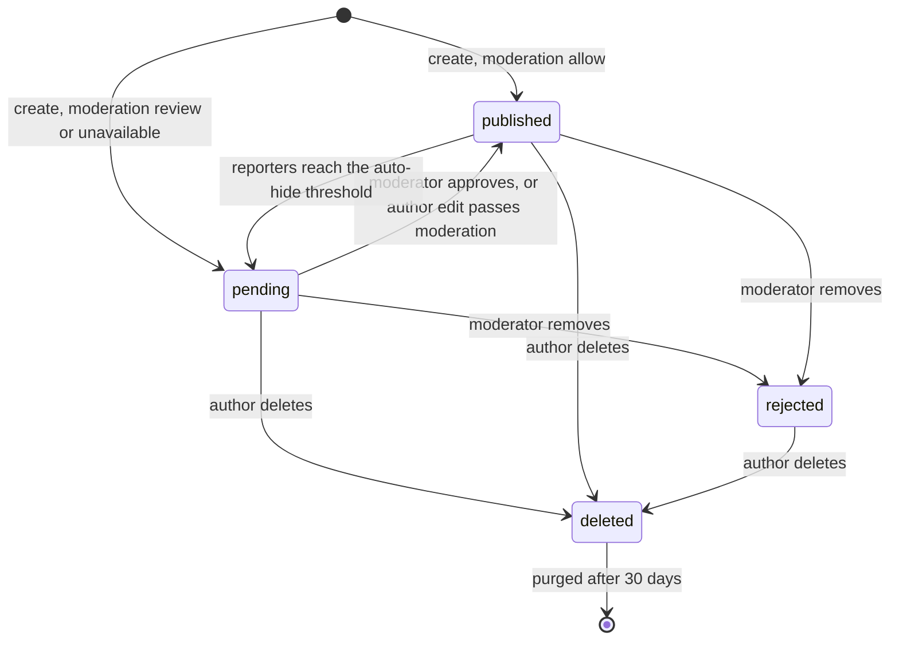

| From        | To          | Who                                    | Guard                                                          | Effects                                                                                                                                        |
| ----------- | ----------- | -------------------------------------- | -------------------------------------------------------------- | ---------------------------------------------------------------------------------------------------------------------------------------------- |
| (new)       | `published` | author                                 | moderation `allow`; author `active`; community not `read_only` | claim media (`attached`), create links, extract hashtags, bump `postsCount`                                                                    |
| (new)       | `pending`   | author                                 | moderation `review` or `degraded`                              | claim media, create links as inactive, notify author "held"                                                                                    |
| `pending`   | `published` | moderator, or system after author edit | moderator in same community; revised content passed moderation | activate links, bump `postsCount`, add hashtag counts                                                                                          |
| `pending`   | `rejected`  | moderator                              | reason category required                                       | release media, links stay inactive, notify author with category (no quote)                                                                     |
| `published` | `pending`   | system (reports)                       | distinct reporters at or above threshold (TBD-13)              | hide from feeds, links inactive, notify moderators; `heldReason = reports`                                                                     |
| `published` | `rejected`  | moderator                              | reason required                                                | remove from feeds and search, links inactive, release media, drop notifications that point to it, notify author                                |
| any live    | `deleted`   | author                                 | author is the owner; moderators use `rejected` instead         | `deletedAt`, `deletedBy`; media deleted from storage and quota released; comments hidden; links inactive; notifications removed; counters down |
| `deleted`   | (purged)    | job                                    | `deletedAt` older than 30 days                                 | hard delete the row, its comments and reactions                                                                                                |

**Held reasons.** `pending` carries `heldReason`: `moderation`, `reports` or `edit-of-pending`. The reason decides what
"approve" means to the moderator and what the author sees.

**Edit rules (FR-POST-10 to 13).**

- Edit of a `published` post: moderate the new content. `allow` swaps it in and sets `editedAt`. `review` or `degraded`
  stores it as `pendingRevision` and leaves the live version untouched. `reject` returns 422 and changes nothing.
- A held revision moves forward when a moderator approves it (swap in) or removes it (discard the revision; the post
  stays published with the old text). Media claimed by a discarded revision is released.
- Edit of a `pending` post: allowed, re-moderated, and if it passes the post becomes `published`.
- Edit of a `rejected` or `deleted` post: refused (409). Appeals are FR-MOD-10, not editing.

## 3. Comment

Same four states as a post, because FR-MOD-7 queues held comments and FR-CMT-9 moderates them. The SRS never named a
comment status, so v1.4 should add it.

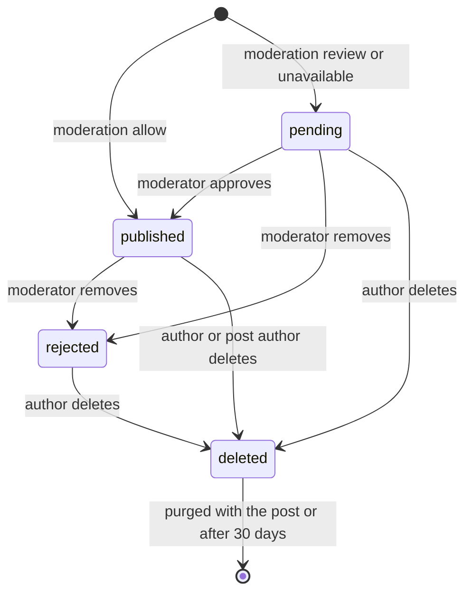

- A comment is only readable while **its post is `published`** and its thread parent is not `deleted`/`rejected`. The
  read predicate checks the post, so deleting a post needs no write to every comment to hide them; the purge job removes
  them later.
- Deleting a **top-level** comment moves its replies to `deleted` with `deletedBy = parent` in one `updateMany`, and
  adjusts `commentsCount` by the number of rows that actually changed.
- `repliesCount` and the post's `commentsCount` count only `published` rows, so `pending → published` increments them
  and any move out of `published` decrements them.
- Edit: re-moderate; on `allow` swap text and set `editedAt`; on `review` keep the old text live with a
  `pendingRevision`, as for posts.

## 4. Media (built, with two additions)

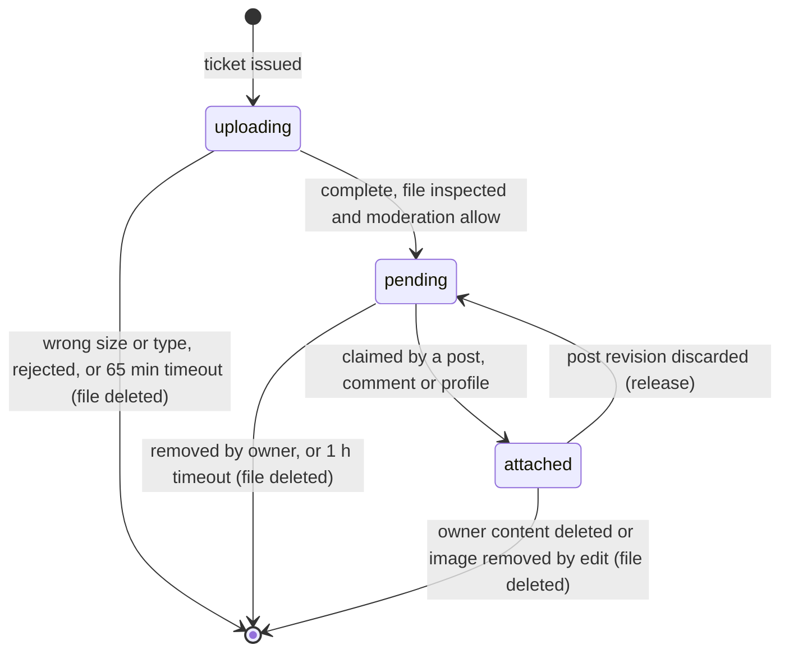

Additions the posts module needs: `attached` records **which entity owns it** (`ownerType`, `ownerId`) so a deleted
post releases exactly its own images, and a **revision claim** (`attached` with `revisionOf`) so a held edit can claim
new images without detaching the live ones.

## 5. Membership

Created lazily on a person's first authenticated action in a community (FR-AUTH-2). There is no "invited" state.

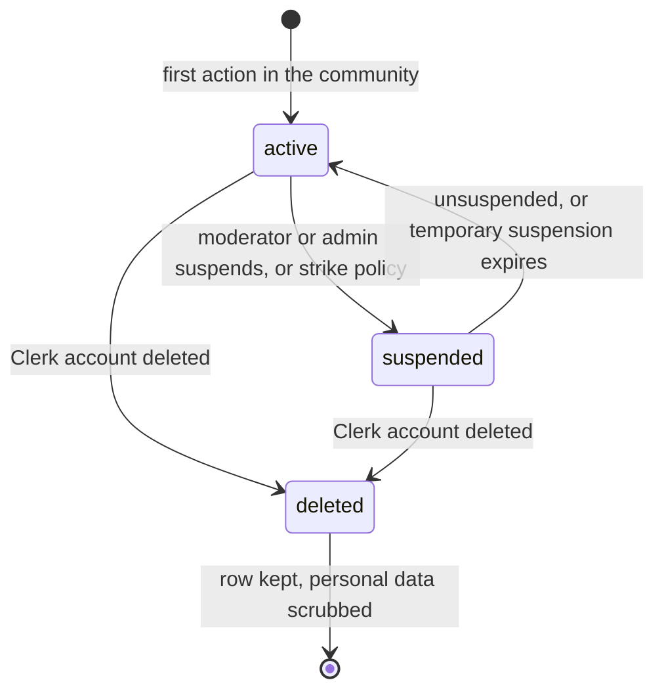

- A temporary suspension stores `suspendedUntil` and is **evaluated when read** (`status = suspended and now < until`),
  not flipped by a job, so it cannot get stuck.
- Role (`member`, `moderator`, `admin`) is not a status and changes independently, only by a community admin
  (FR-ADM-1). A suspended moderator keeps the role but cannot use it.
- `deleted` is entered once for **every membership of the Clerk account** (FR-ACC-1, FR-ACC-2). It starts the 30-day
  clock for that person's posts, comments and images. It is irreversible because Clerk will not reuse the id.
- Writes: `suspended` gets 403, `deleted` gets 401 (FR-AUTH-5). Reads of a `deleted` profile get 404.

## 6. Community

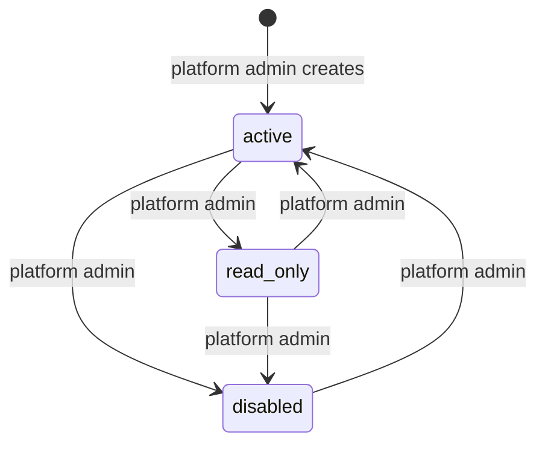

| State       | Reads                       | Writes  | Notes                                                 |
| ----------- | --------------------------- | ------- | ----------------------------------------------------- |
| `active`    | allowed                     | allowed | normal                                                |
| `read_only` | allowed                     | 403     | maintenance or winding down (FR-COM-12)               |
| `disabled`  | 404 as if it does not exist | 404     | IR-API-12; data is kept, nothing is served or counted |

The state is checked once, in the middleware that resolves `{community}` from the path, so no feature can forget it.

## 7. Report

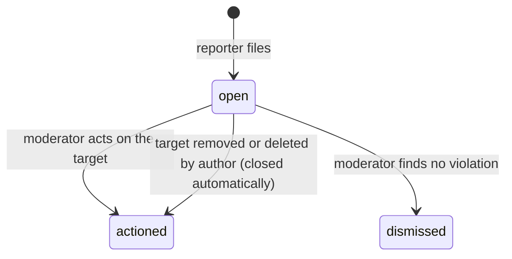

- Uniqueness: one `open` report per reporter and target. After a report closes, the same person may report again.
- Reports are **grouped by target**; closing the group closes every report in it with the same outcome.
- Reaching the threshold of distinct reporters triggers the post transition `published → pending` (section 2). A
  `dismissed` outcome on an auto-held post moves it back to `published`; `actioned` moves it to `rejected`.
- The reporter's id is never returned to the reported member (FR-RPT-5).

## 8. Link

Two independent fields, plus one function that combines them at click time.

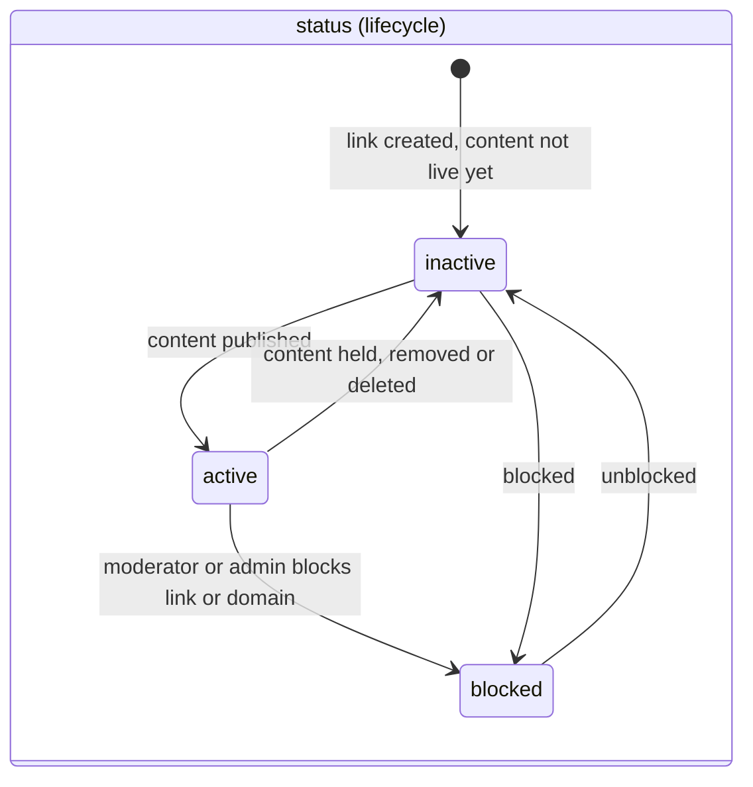

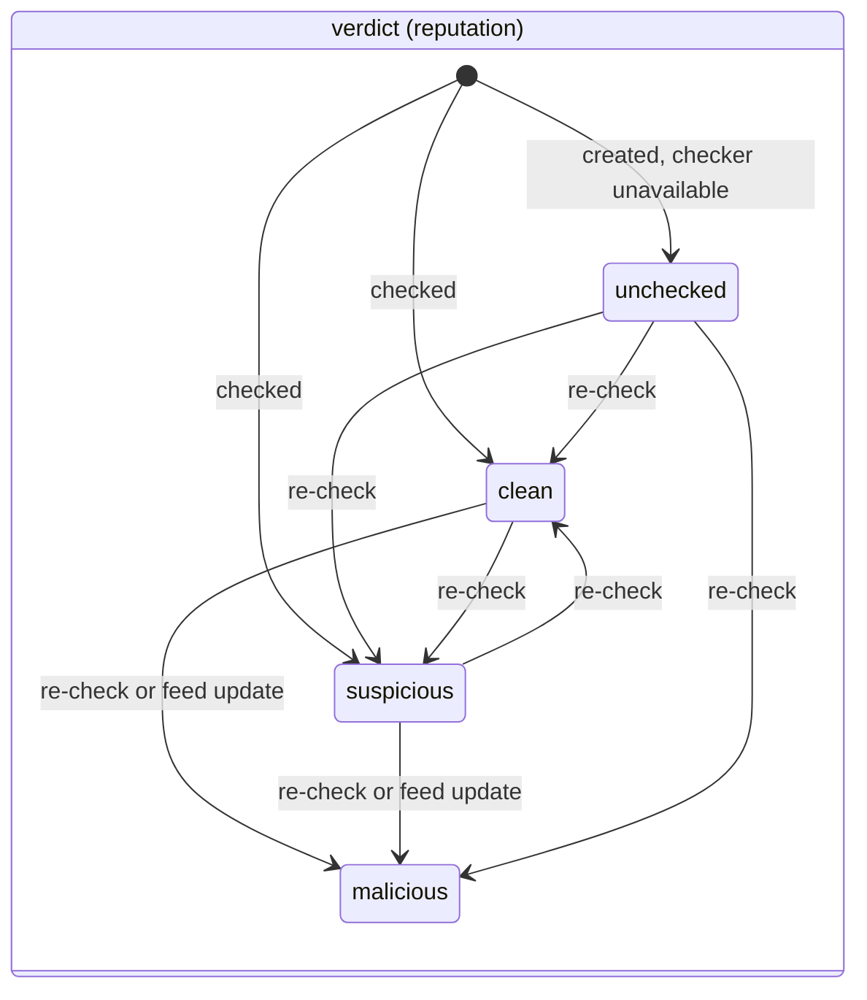

A link whose first check says `malicious` is never created: the content is refused with 422 (FR-LNK-11). So
`malicious` only appears from a later re-check, and it is not left again unless a moderator overrides it.

**Click-time decision** (first matching row wins; FR-LNK-16 to 19, D-12):

| Lookup result                                                   | Response                                         |
| --------------------------------------------------------------- | ------------------------------------------------ |
| code not found                                                  | 404, no detail                                   |
| `status = inactive`                                             | 410 Gone                                         |
| `status = blocked`, or `verdict = malicious`, or domain blocked | 403 page saying it is blocked                    |
| last check older than 24 h and re-check fails or times out      | warning page                                     |
| `verdict = suspicious` or `unchecked`, or lookalike host        | warning page (Continue / Back, no auto-redirect) |
| `verdict = clean` and host is not a lookalike                   | 302 to the stored `normalizedUrl`                |

Link `status` is a **projection of its content's state**: it follows the post or comment (published means active,
anything else means inactive) and is changed by the same code that changes the content. That is how FR-LNK-20 holds
without a separate sweep.

## 9. Notification

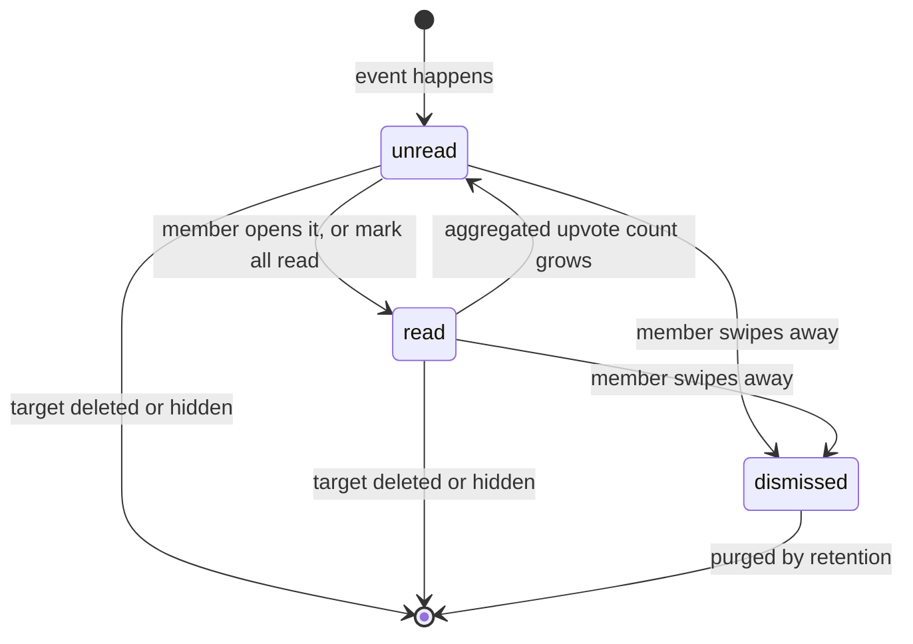

- Likes aggregate into one row per post and recipient, updated at most once per 10 minutes (FR-NTF-3). New likes after
  it was read flip it back to `unread` with the new count.
- When a post or comment leaves `published`, notifications that point to it are removed (FR-NTF-9). Notifications about
  moderation outcomes (`moderation` type) are kept even though the content is gone, and never quote it.

## 10. Storage account (built)

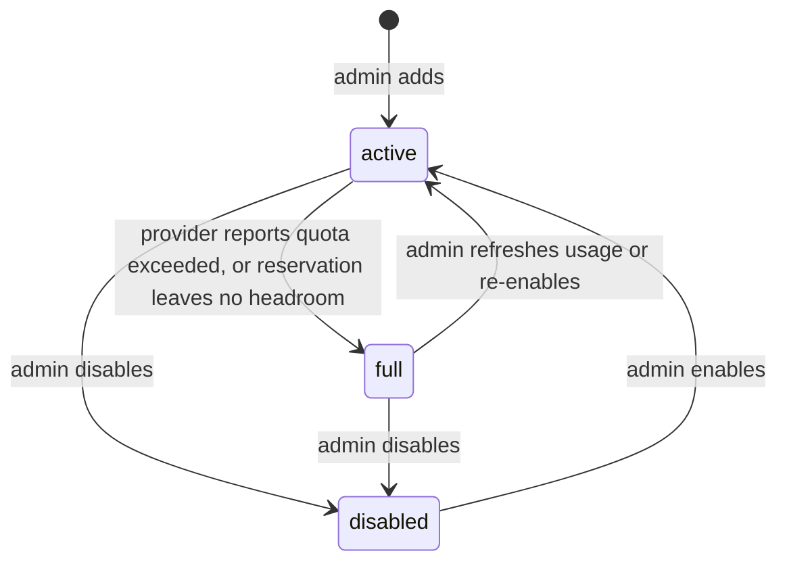

Already implemented in `storage-account.model.ts` (`active|full|disabled`). The `full → active` edge should be
re-checked against `StorageAdminService` when the admin refresh endpoint is touched next.

## 11. Client upload (SDK, not stored)

The app models uploading, completed and canceled only. The SDK adds `failed` and a resumable path because mobile
networks drop (SRS Appendix C).

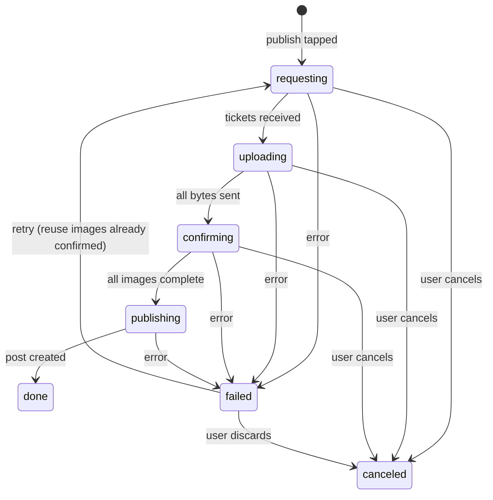

`canceled` aborts the request and calls `DELETE /media/{id}` for tickets already issued. `Idempotency-Key` on
`POST /posts` makes a retry after a lost response safe (TBD-14).

## 12. Cross-entity effects

One place to look up "what happens to X when Y changes".

| Event                              | Post                                                             | Comments                              | Media                   | Links                                                          | Notifications                      | Counters                                  |
| ---------------------------------- | ---------------------------------------------------------------- | ------------------------------------- | ----------------------- | -------------------------------------------------------------- | ---------------------------------- | ----------------------------------------- |
| Author deletes post                | `deleted`                                                        | hidden by predicate, purged later     | deleted, quota released | `inactive`                                                     | removed                            | author `postsCount`, hashtag counts down  |
| Moderator removes post             | `rejected`                                                       | hidden by predicate                   | deleted, quota released | `inactive`                                                     | removed, author notified           | same                                      |
| Report threshold reached           | `pending` (`heldReason=reports`)                                 | hidden by predicate                   | kept                    | `inactive`                                                     | kept                               | feed counts down                          |
| Moderator approves held post       | `published`                                                      | visible again                         | kept                    | `active`                                                       | author may be told it was approved | up                                        |
| Author deletes comment             | n/a                                                              | `deleted`; replies `deleted` (parent) | n/a                     | `inactive`                                                     | removed                            | post `commentsCount` down by rows changed |
| Member suspended                   | their posts hidden by predicate (status kept)                    | same                                  | kept                    | stay `active`; hidden with content                             | none                               | none                                      |
| Clerk account deleted              | all memberships `deleted`; posts `deleted` (`deletedBy=account`) | `deleted`                             | deleted                 | `inactive`                                                     | removed                            | recomputed                                |
| Block A to B                       | hidden both ways by predicate                                    | hidden both ways                      | none                    | none                                                           | removed both ways                  | follows removed, counts down              |
| Community `read_only` / `disabled` | unchanged                                                        | unchanged                             | unchanged               | redirects keep working for `read_only`; `disabled` answers 404 | none                               | none                                      |

Suspension is deliberately a **read-time filter**, not a rewrite of every post: lifting it must restore everything
instantly and without risk of a half-finished bulk update.

## 13. Implementation plan

**Core (shared, feature-agnostic)**

1. `core/state/state-machine.ts`: `defineMachine({ name, states, transitions })` returning `canTransition(from, to)`,
   `assertTransition(from, to)` (throws `AppError.conflict` naming both states), `allowedFrom(to)` (the `$in` list for the
   guarded update) and `toMermaid()`.
2. `BaseRepository.transition(filter, machine, to, patch)`: runs the guarded `findOneAndUpdate`, returns the updated
   document or `null`. Services turn `null` into 404 or 409 with one extra read, only on the failure path.
3. A scoped-repository base that adds `communityId` to every filter (NFR-ISO-1), so machines and tenancy are enforced
   in the same place.

**Per entity**

4. `<entity>.states.ts` next to each model exporting its machine (`post.states.ts`, `comment.states.ts`, …) and the
   `isVisibleTo` predicate for that entity.
5. Services call `repo.transition(...)` and then an `onTransition` handler that runs the effects in section 12. Effects
   are small idempotent functions (`releaseMedia`, `setLinksActive`, `removeNotificationsFor`), each owned by the module
   it touches and reached through a port, as moderation is today.

**Tests**

6. **Table test per machine**: for every ordered pair of states, assert allowed or refused exactly as the table says.
   A new state fails the test until its row is written.
7. **Race tests**: run two conflicting transitions at once (two moderators, author delete vs moderator approve) against
   the in-memory MongoDB and assert exactly one wins and counters stay correct.
8. **Effect tests**: for each row of section 12, assert the other entities end in the stated state, and that running the
   effect twice changes nothing.
9. **Visibility tests**: one matrix of (state × viewer: author, other member, moderator, visitor, blocked, suspended
   author) per entity against feed, profile, search, detail and link.
10. **Doc check**: a unit test (or `pnpm docs:states`) renders each machine with `toMermaid()` and fails if the diagram
    in this file differs, so the picture cannot drift from the code.

**Order of work** (each step ships with its tests, CR-6)

1. Community-aware refactor (Account, Membership, Community registry, scoped repository). Every machine below needs
   `communityId`, so this comes first.
2. `core/state` helper and the Membership machine (small, proves the pattern).
3. Posts (create, edit with `pendingRevision`, delete, feed, hashtags) with media attach and release.
4. Link service hooks into post states (links created inactive, activated on `published`), then redirect and warning pages.
5. Comments, then reactions and bookmarks, follow and block.
6. Reports and the moderator queue (this is where `pending` transitions get their human actors).
7. Notifications, then search.
8. Purge and reconcile jobs (30-day purge, link and counter reconciliation), then rate limiting.
9. SDK, including the client upload machine.

## 14. SRS changes this plan needs (proposed v1.4)

1. Replace the diagram in 3.8.1 with section 2 (held edit becomes `pendingRevision`, not a post state) and add
   `pending → published` by author edit and `published → pending` by reports.
2. Add a comment status (`published|pending|rejected|deleted`) to FR-CMT and to the Comment entity in 3.5.
3. Add `heldReason`, `pendingRevision`, `deletedBy` and `suspendedUntil` to the entities in 3.5, plus Media `ownerType`
   and `ownerId`.
4. Add Report status `open|actioned|dismissed`, Link `status` as a projection of content (FR-LNK-20), and the
   click-time decision table to FR-LNK.
5. Add one requirement: every status change shall be a single guarded atomic update that records actor and reason, and
   shall be rejected with 409 when the record is no longer in the expected state.
6. Fix a small inconsistency: FR-PRF-1 says `/members/me` while Appendix D says `/users/me` becomes `/members/me`;
   keep `/members/…` everywhere.
